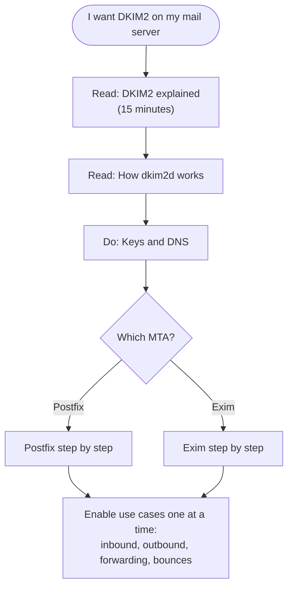

# DKIM2 for Mail Administrators: Start Here

You run Postfix or Exim, you know SPF, DKIM, and DMARC, and you want to add
DKIM2 without first reading three Internet-Drafts. This guide set is for you.
It explains what DKIM2 does in plain words, what every tag in the headers
means, how `dkim2d` works, how to create keys and DNS records, and how to wire
everything into Postfix or Exim, one use case at a time.

Everything here describes this repository's implementation of
`draft-ietf-dkim-dkim2-spec-09` with `draft-ietf-dkim-dkim2-dns-02`. DKIM2 is
still a draft: keep your existing DKIM, SPF, and DMARC setup running next to
it. All names in the examples are reserved `.test` domains; replace them with
your own.

## The five-minute picture

Classic DKIM is a seal on an envelope: the sender seals the message, and every
later change breaks the seal. Forwarders and mailing lists therefore break
DKIM all the time.

DKIM2 is a parcel with a **handover log**. Every system that sends the
message on adds one line to the log: "I received this from A, I hand it to B,
and this is what I changed." The receiver reads the log from the newest entry
back to the oldest and can check every step.

```text
 alice@example.test                lists.test                 destination.test
 +------------------+   SMTP    +----------------+   SMTP   +------------------+
 | example.test MTA | --------> | mailing list   | -------> | receiving MTA    |
 | signs  i=1       |           | changes Subject|          | verifies i=2,    |
 |  mf=alice@...    |           | signs  i=2     |          | undoes the change|
 |  rt=team@lists   |           |  mf=team-bounces          | with the Recipe, |
 +------------------+           |  rt=bob@dest   |          | verifies i=1     |
                                | adds Recipe    |          +------------------+
                                +----------------+
```

Three ideas carry the whole protocol:

1. **Each hop signs the SMTP envelope.** `mf=` (MAIL FROM) and `rt=`
   (RCPT TO) are part of the signature. A message replayed to other
   recipients no longer matches its last signature.
2. **Changes are documented, not destructive.** A system that changes the
   message adds a `Message-Instance` with a Recipe that recreates the previous
   version, so older signatures still verify.
3. **Bounces travel back along the chain.** A bounce goes to the `mf=` of the
   newest signature, never to an address taken from the message body or
   headers. That ends backscatter.

The full explanation with a real signed message is
[DKIM2 explained](dkim2-explained.md).

## Pick your path



| Guide | You will learn |
| --- | --- |
| [DKIM2 explained](dkim2-explained.md) | The chain of custody, a real signed and revised message taken apart line by line, the four mail-flow use cases and why each one works the way it does. |
| [Tag and flag cheat sheet](tag-cheatsheet.md) | Every header tag (`i=`, `m=`, `t=`, `mf=`, `rt=`, `nd=`, `d=`, `s=`, `f=`, `n=`, `h=`, `r=`), every flag (`exploded`, `feedback`, `feedhere`), DNS tags, and verification states, with "when do I care?" notes. |
| [How dkim2d works](dkim2d-explained.md) | What the daemon receives, its routes and capabilities, policy modes, replay, the signing datasource, and a live `curl` example. |
| [Keys and DNS](keys-and-dns.md) | Choosing selectors and algorithms, generating keys with `dkim2d datasource key generate`, publishing and testing TXT records, the `f=strict` policy record, and rotation. |
| [Postfix step by step](postfix-quickstart.md) | Building, installing, and configuring `dkim2d` and `dkim2-milter` for inbound verification, outbound signing, forwarding, auto-replies, and bounces. |
| [Exim step by step](exim-quickstart.md) | The same use cases with the Exim `local_scan` service and transport filters. |

## Which use cases do I need?

Most sites need the first two rows on day one and add the others later.

| Use case | What happens | Postfix | Exim |
| --- | --- | --- | --- |
| **Inbound verification** | Check DKIM2 on mail from the Internet and add `Authentication-Results`. | `dkim2-milter` mode `inbound` | `local_scan` service |
| **Outbound signing** | Sign mail your users and applications send. | `dkim2-milter` mode `originator` | `transport_filter` `filter sign` |
| **Forwarding** | Re-sign mail you pass on (aliases, `.forward`, lists, relays). | limited, see the guide | `transport_filter` `filter revise` |
| **Auto-replies** | Sign vacation and notification replies sent with `MAIL FROM:<>`. | `originator` with `null_sender: header_from` | not available |
| **Own bounces** | Sign the bounces your MTA generates. | `dkim2-milter` mode `postfix_dsn` (patched Postfix) | not available |
| **Received bounces for forwarded mail** | Rebuild the bounce and send it back to the previous hop. | `dkim2-dsn-propagator` | `dkim2-dsn-propagator` (unqualified) |

"Not available" means the project ships no component for it; such mail leaves
unsigned, exactly as it does today.

## Recommended rollout

1. **Observe.** Install the inbound path with `policy.mode: testing`. Nothing
   is rejected; you only get `Authentication-Results: ...; dkim2=...` headers
   and metrics.
2. **Sign.** Publish DNS keys, then enable outbound signing for one domain.
   Check the result with a public validator such as
   [dkim2.pub](https://dkim2.pub).
3. **Extend.** Add bounces, auto-replies, and forwarding one at a time.
4. **Enforce.** Switch inbound to `permissive` or `strict` only when your
   reports show that legitimate mail passes.

## Command help and reference pages

Every binary documents its commands: `dkim2d --help`, `dkim2-milter --help`,
`dkim2-dsn-propagator --help`, `dkim2ctl --help`, and `dkim2-exim --help`.
These guides teach and give working starting points; the complete,
authoritative references stay where they are:

- [`cmd/dkim2d/README.md`](../../cmd/dkim2d/README.md): every daemon
  configuration key.
- [`cmd/dkim2-milter/README.md`](../../cmd/dkim2-milter/README.md): every
  Milter key and mode.
- [`cmd/dkim2-dsn-propagator/README.md`](../../cmd/dkim2-dsn-propagator/README.md):
  the bounce propagation adapter.
- [`docs/operations/exim-adapter.md`](../operations/exim-adapter.md): Exim
  operations and the rebuild requirement.
- [`docs/operator/postfix-admin.md`](../operator/postfix-admin.md) and
  [`docs/operator/deployment-walkthrough.md`](../operator/deployment-walkthrough.md):
  the detailed decision guide and the signal-flow walkthrough for experienced
  operators.
- [`docs/operator/postfix-compose.md`](../operator/postfix-compose.md): the
  hardened container deployment that the project qualifies.
- [`docs/specs/openapi/dkim2d.yaml`](../specs/openapi/dkim2d.yaml): the
  authoritative HTTP contract.
- [`docs/reference/known-limitations.md`](../reference/known-limitations.md):
  what does not work yet.
