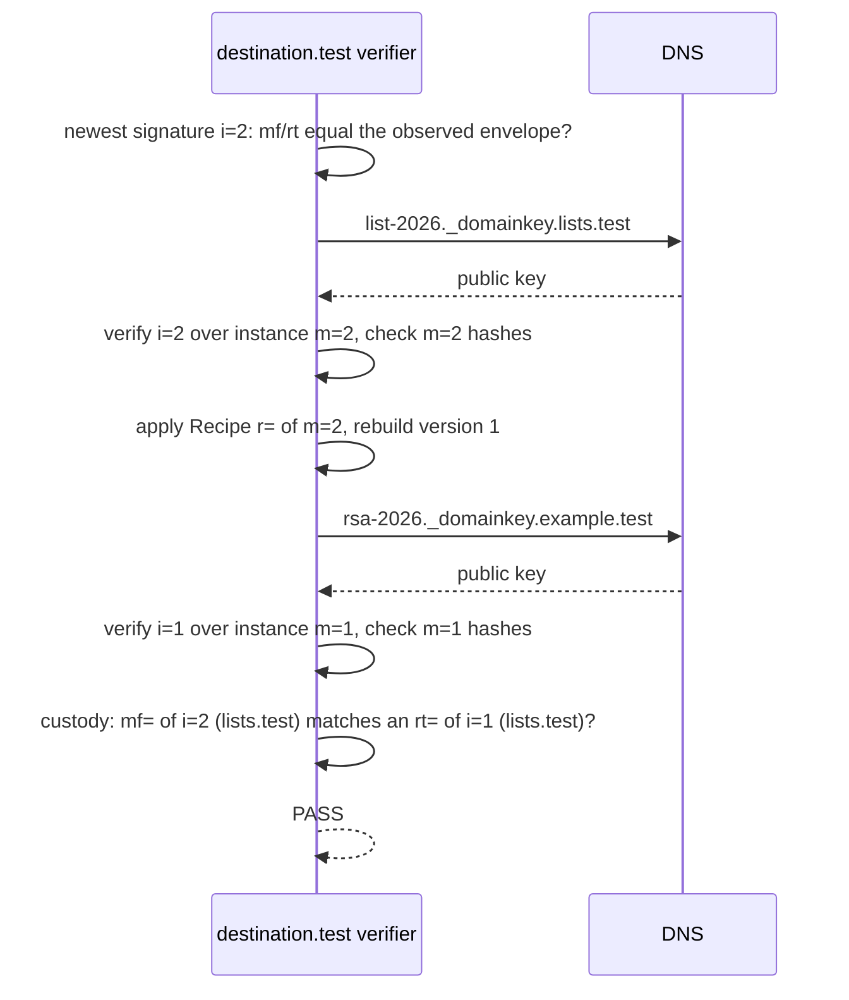
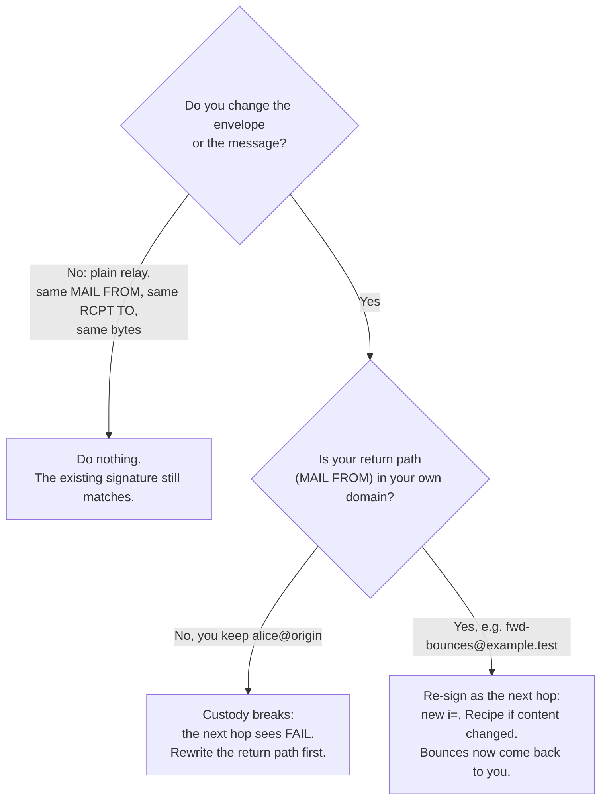
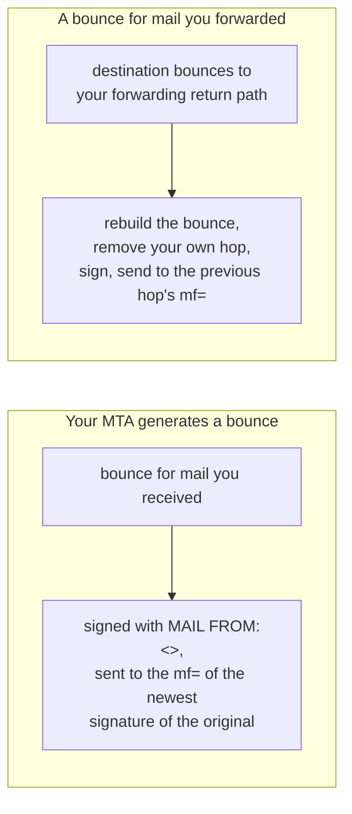

# DKIM2 Explained

This page explains DKIM2 with one real message. The headers below were
produced by this repository's signer for this page; only the domains are
reserved `.test` names. Read it once, and the headers of every DKIM2 message
will make sense.

## DKIM versus DKIM2 in one table

| Question | DKIM (RFC 6376) | DKIM2 |
| --- | --- | --- |
| Who signs? | Usually only the origin | Every system that sends the message on |
| What is signed? | Selected headers and the body | Headers, body, **and the SMTP envelope** (`MAIL FROM`, `RCPT TO`) |
| A mailing list changes the Subject | Signature breaks | The list documents the change in a Recipe; the old signature still verifies |
| A message is replayed to 10,000 other recipients | Signature still valid | The envelope no longer matches the last signature, so it does not verify |
| A bounce is sent | To any address the message claims | Only to the `mf=` of the newest signature; nothing is sent when that is `<>` |
| DNS key record | `selector._domainkey.domain` TXT | The same place and the same `v=DKIM1` format |

The DNS side is deliberately familiar. The news is in the headers and in the
rule that every hop signs.

## Step 1: Alice sends a message

Alice at `example.test` writes to the list `team@lists.test`. Her MTA sends
`MAIL FROM:<alice@example.test>` and `RCPT TO:<team@lists.test>`. Before the
message leaves, the signer adds two header fields on top:

```text
Message-Instance: m=1;
	h=sha256:ioEofzEkFYI3AA0yyaZ0hXrCL5XgnAryc0JuruwbKmw=:4mJHAbL+xCgsdx0VdjCLBf9XNhsJ9i4GL0+wLEShQHU=;
DKIM2-Signature: i=1;
	m=1;
	t=1700000000;
	mf=PGFsaWNlQGV4YW1wbGUudGVzdD4=;
	rt=PHRlYW1AbGlzdHMudGVzdD4=;
	d=example.test;
	s=rsa-2026:rsa-sha256:WVja93QK6JnZCYCRr0rxDQ3CLe7xpQLt0b3B5GyaWhoTmDWJ3IuEqUe4oEFFTM1m
	OB2dVf79XWbo6swClf2lMbepLjqywXuBUoUVssZv5pZc2kTgO4pUFNHIei1GIH6v
	...
	h+fmRZtOBIpkAWdmiqC7UQ==;
From: Alice <alice@example.test>
To: team@lists.test
Subject: Grillfest am Samstag
Message-ID: <demo-1@example.test>

Wer bringt die Wuerstchen mit?
```

Read it from top to bottom:

```text
Message-Instance  m=1                 "This is version 1 of the message."
                  h=sha256:HDR:BODY   "Version 1 has this header hash and this body hash."

DKIM2-Signature   i=1                 "I am the first hop in the chain."
                  m=1                 "I sign version 1."
                  t=1700000000        "I signed at this Unix time."
                  mf=PGFs...dD4=      base64 of "<alice@example.test>": the MAIL FROM I used
                  rt=PHRl...dD4=      base64 of "<team@lists.test>":   the RCPT TO I used
                  d=example.test      "I sign for this domain."
                  s=rsa-2026:rsa-sha256:<signature>
                                      "Look up selector rsa-2026 in DNS, it is an RSA key,
                                       and this is the signature."
```

Two details surprise most people:

- **`mf=` and `rt=` are base64.** Decode them with
  `echo PGFsaWNlQGV4YW1wbGUudGVzdD4= | base64 -d`. The angle brackets are part
  of the value: `<alice@example.test>`. A bounce sender `<>` encodes as
  `PD4=`.
- **The hashes are in the Message-Instance, not in the signature.** The
  signature is computed over the Message-Instance and DKIM2-Signature
  fields, so it protects the hashes, the earlier hops, and its own envelope
  tags. That split is what makes revisions possible (Step 2).

The receiver at `lists.test` checks: is the newest signature's `mf=`/`rt=`
the envelope I just saw? Does the key from
`rsa-2026._domainkey.example.test` verify the signature? Do the header and
body hashes match? If all of that holds, the message is **PASS**.

## Step 2: The mailing list changes the Subject and forwards

The list prefixes the subject with `[team]` and sends the message to Bob at
`destination.test`, with its own return path
`MAIL FROM:<team-bounces@lists.test>` and `RCPT TO:<bob@destination.test>`.
It adds a new block on top of the old one:

```text
Message-Instance: m=2;
	h=sha256:91xHxSvFO0E1nGmMAOpvn6BcWOY9/1RJzMhXZw9XCjk=:4mJHAbL+xCgsdx0VdjCLBf9XNhsJ9i4GL0+wLEShQHU=;
	r=eyJoIjp7InN1YmplY3QiOlt7ImQiOlsiIEdyaWxsZmVzdCBhbSBTYW1zdGFnIl19
	XX19;
DKIM2-Signature: i=2;
	m=2;
	t=1700000000;
	mf=PHRlYW0tYm91bmNlc0BsaXN0cy50ZXN0Pg==;
	rt=PGJvYkBkZXN0aW5hdGlvbi50ZXN0Pg==;
	d=lists.test;
	s=list-2026:rsa-sha256:W9kjXHEiQBxod5hxspNZANHIk2B6/WZUnfHUiu6iHKR5L2KzEGh/EP26i3CdhRUG
	...
	zlghHNIMmvhem++ATzbDlw==;
Message-Instance: m=1;
	h=sha256:ioEofzEkFYI3AA0yyaZ0hXrCL5XgnAryc0JuruwbKmw=:4mJHAbL+xCgsdx0VdjCLBf9XNhsJ9i4GL0+wLEShQHU=;
DKIM2-Signature: i=1;
	... unchanged from Step 1 ...
From: Alice <alice@example.test>
To: team@lists.test
Subject: [team] Grillfest am Samstag
Message-ID: <demo-1@example.test>

Wer bringt die Wuerstchen mit?
```

What changed:

- `Message-Instance: m=2` has a new header hash (the Subject changed) and the
  **same body hash** (the body did not).
- `r=` is the **Recipe**. Decoded, it is
  `{"h":{"subject":[{"d":[" Grillfest am Samstag"]}]}}`: "to get version 1
  back, replace the Subject value with ` Grillfest am Samstag`". A Recipe
  describes how to undo a change; it does not need to explain why.
- `DKIM2-Signature: i=2` signs version 2 with the list's own envelope:
  `mf=<team-bounces@lists.test>`, `rt=<bob@destination.test>`.

## Step 3: Bob's server verifies the whole chain



The last line is the **chain of custody**. Every hop after the first must
send *from* a domain that the previous hop sent *to*. The list was a
recipient of hop 1 (`rt=<team@lists.test>`), and it sends from
`team-bounces@lists.test`. The chain is unbroken.

Each signature's `d=` must also match its own `mf=` domain (a parent domain
is fine). The list cannot sign as `d=example.test`, and Alice's server cannot
sign as `d=lists.test`.

## Which header fields count?

Unlike DKIM, DKIM2 does not let the signer pick headers. The header hash
covers **every** header field except these, which systems on the way may add
or change freely:

- `Received` (and `Received-*`), `Return-Path`, `Delivered-To`
- `Authentication-Results`
- every `X-*` field
- `DKIM-Signature` and the ARC fields `ARC-Seal`, `ARC-Message-Signature`,
  `ARC-Authentication-Results`
- `Message-Instance` and `DKIM2-Signature` themselves
- the rare `Apparently-To`, `DL-Expansion-History`, `Original-Recipient`,
  `SIO-Label-History`, `X400-Received`, `X400-Trace`

So a classic DKIM signer, an ARC sealer, a spam filter adding `X-Spam-*`, or
your `Authentication-Results` may run after DKIM2 signing. A tool that adds
a footer, tags the Subject, or adds a `List-Id` must run **before** it, or the
hop that does it must revise the message.

## The four use cases and why they look the way they do

### Outbound: your users send mail

You sign `i=1` with your domain. The envelope you sign must be exactly the
envelope you send. Two practical consequences follow:

- **One recipient per signed copy.** `rt=` lists the recipients. If a
  message goes to `bob` and to a hidden Bcc recipient `eve` in one
  transaction, putting both into `rt=` would reveal `eve` to `bob`. This
  implementation therefore signs exactly one recipient per copy. Your MTA
  must split multi-recipient mail into one-recipient deliveries on the
  signing path; the MTA guides show how.
- **DNS first.** The signer verifies every signature it creates against your
  public DNS key before it hands it out. Without a published key record,
  signing fails instead of producing a signature nobody can verify.

### Inbound: mail from the Internet

You verify and record the result. The outcome is one of five states:

| State | Meaning | Default `strict` policy |
| --- | --- | --- |
| `NONE` | No DKIM2 header at all. This is normal for most mail today. | continue (deliver) |
| `PASS` | Every signature and hash verified, custody is intact. | accept |
| `FAIL` | Verification completed and something does not match: changed body, wrong envelope, broken custody. | reject |
| `PERMERROR` | The DKIM2 data is broken: malformed header, missing key, bad Recipe. | reject |
| `TEMPERROR` | Temporary problem, mostly DNS timeouts. | defer (451) |

A `NONE` message is never rejected for missing DKIM2. How strictly you treat
the other states is local policy; start with `testing`, which only reports.

### Forwarding: aliases, lists, relays

This is where DKIM2 differs most from DKIM, and where most questions come
from.



Why must a forwarder rewrite its return path? Look at the custody rule
again: hop `i=2` must send *from* a domain that hop `i=1` sent *to*. If
`bob@example.test` forwards to `carol@destination.test` but keeps
`MAIL FROM:<alice@origin.test>`, then `mf=` of the new hop is `origin.test`,
which was never a recipient of hop 1. The forwarder must take responsibility
for the message by using its own return path. That is also why bounces come
back to the forwarder, which can then pass them back to the origin (see
below).

Do not change a message after it has been signed. A footer, a disclaimer, a
rewritten header, or a content filter that runs *after* the DKIM2 signer
breaks the signature. Order your filters so that the signer is the last
system that touches the message.

### Bounces: in both directions



- **Your own bounces.** When you cannot deliver a DKIM2 message, the bounce
  goes to the `mf=` of its newest signature and is signed with `mf=<>`. The
  bounce is signed only for a domain that was one of the original's
  recipients (`rt=`); otherwise it leaves unsigned like a classic bounce.
- **Bounces for forwarded mail.** Because you forwarded with your own return
  path, the destination's bounce reaches you. DKIM2 lets you rebuild it for
  the system before you, so the original sender learns about the failure
  without you leaking where you forwarded the message.
- **Auto-replies are not bounces.** A vacation reply also uses
  `MAIL FROM:<>`, but it is a new message from your user. It is signed like
  outbound mail with the From domain, and only on trusted outbound paths.

## Replay protection in one paragraph

A spammer who gets one signed message can try to resend it to many other
addresses. The envelope binding already stops the simple version: the new
`RCPT TO` does not match `rt=`. A forwarder, however, legitimately re-sends.
`dkim2d` can therefore remember which signed messages it has seen (the
replay store) and refuse a second copy. A message carrying only the origin's
`i=1` signature is a direct delivery and is not counted. The `exploded` flag
tells the receiver that a hop deliberately fanned one message out to several
recipients, so several copies are expected.

## What to read next

- Every tag, flag, and state on one page:
  [Tag and flag cheat sheet](tag-cheatsheet.md).
- The daemon that does all of this: [How dkim2d works](dkim2d-explained.md).
- Your DNS: [Keys and DNS](keys-and-dns.md).
