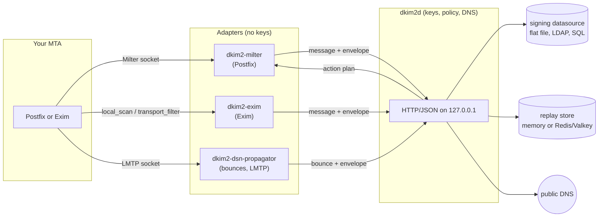

# How dkim2d Works

`dkim2d` is the only program in this project that understands DKIM2 and the
only one that touches private keys. Postfix and Exim never talk to it
directly. Small adapters sit between the MTA and the daemon: they collect
the message and the SMTP envelope, ask `dkim2d` what to do, and apply the
answer.



## What the daemon receives

Every request is one JSON document with three things:

1. **The message**, complete, as base64 (`raw_rfc5322_base64`), plus a
   `fidelity` label that says how the adapter obtained the bytes (for
   example `milter_reconstructed_crlf`).
2. **The SMTP envelope**: `mail_from` and `rcpt_to`, exactly as the MTA used
   them, with angle brackets.
3. **The context**: for signing, the tenant and the signing domain; for
   inbound reports, the `authserv-id` of your server.

A real inbound request for an unsigned message:

```json
{
  "api_version": "v1",
  "draft": "draft-ietf-dkim-dkim2-spec-09",
  "message": { "raw_rfc5322_base64": "RnJvbTogQ2Fyb2wg...", "fidelity": "raw_rfc5322" },
  "smtp": { "mail_from": "<carol@origin.test>", "rcpt_to": ["<bob@example.test>"] },
  "reporting": { "authserv_id": "mx.example.test" }
}
```

The request never contains a key, a selector, or an algorithm. The daemon
picks those itself from its datasource, so a compromised adapter cannot
choose them.

## What the daemon answers

An answer has a **result**, a **disposition**, and an **action plan**. The
real answer to the request above, shortened:

```json
{
  "verification": { "state": "NONE", "primary_reason": "none" },
  "policy": { "mode": "testing", "verdict": "continue" },
  "replay": { "class": "not_checked" },
  "disposition": "continue",
  "actions": [
    { "type": "add_header", "name": "Authentication-Results",
      "value": "mx.example.test; dkim2=none" }
  ]
}
```

For a signed message whose key is missing in DNS, the same daemon answered:

```json
{
  "authentication": { "state": "PERMERROR", "primary_reason": "missing_key" },
  "policy": { "mode": "testing", "primary_reason": "testing_mode_observe", "verdict": "continue" },
  "disposition": "continue",
  "actions": [
    { "type": "add_header", "name": "Authentication-Results",
      "value": "mx.example.test; dkim2=permerror (reason=missing_key)" }
  ]
}
```

| Disposition | The adapter does |
| --- | --- |
| `accept` | Apply the actions, deliver. |
| `continue` | Apply the actions (if any), deliver. Used for `NONE` and in `testing` mode. |
| `reject` | `550 5.7.1` (inbound) or no delivery (outbound). |
| `tempfail` | `451 4.7.1`; the sending MTA retries later. |

The adapter can only add the header fields the daemon names:
`Message-Instance`, `DKIM2-Signature`, `Authentication-Results`, and the
optional `X-DKIM2-Info`. It cannot rewrite the body, change recipients, or
invent a result. If anything in the answer looks wrong, or the daemon is
unreachable, the adapter fails closed with a temporary error, so mail waits
in the queue instead of passing unchecked.

## The routes: one per job

| Route | Job | Typical caller |
| --- | --- | --- |
| `POST /v1/process` | Verify an incoming message, apply local policy and replay checks. | Inbound Milter, Exim `local_scan`, Rspamd |
| `POST /v1/sign` | Sign a new message as `i=1` (your users' outbound mail, auto-replies). | Originator Milter, Exim `filter sign` |
| `POST /v1/revise` | Add your hop to a message you forward; adds a Recipe when the content changed. | Transit Milter, Exim `filter revise` |
| `POST /v1/revise/batch` | Revise one message for a complete fan-out in one call. | Integrations with full original and outgoing evidence |
| `POST /v1/dsn/sign` | Sign a bounce your Postfix generated. | `postfix_dsn` Milter only |
| `POST /v1/dsn/propagate` and `/commit` | Rebuild a received bounce for the previous hop. | `dkim2-dsn-propagator` only |
| `GET /healthz`, `/readyz`, `/metrics` | Liveness, readiness, Prometheus metrics. | Monitoring |

## Capabilities: a separate key for every door

Each working route needs its own **capability**: a file with 32 random
bytes. The daemon and the adapter that uses the route each get a copy of the
same file. The adapter sends it as an HTTP header; a wrong or missing value
gets `403` before any work happens.

```text
                     process.cap      sign.cap       dsn-sign.cap
inbound Milter  ---->  [door 1]
originator Milter ------------------>  [door 2]
postfix_dsn Milter ---------------------------------->  [door 3]
```

Why the effort? A compromised inbound adapter can then only ask "please
verify this", never "please sign this". Rules:

- Every capability is different. Never copy one file to two routes.
- Create them with `openssl rand 32 > file`: exactly 32 raw bytes, not hex,
  not base64, no newline.
- They never appear in a command line, environment variable, or log. The
  configuration only contains their paths.
- `server.capability_file` (the process capability) is always required, even
  on a daemon that only signs. On such a daemon, simply give that file to no
  adapter.

## Three valid shapes

A daemon is configured for exactly one of these shapes. The MTA guides use
two daemons: one **inbound** daemon without keys and one **signer** daemon.

| Shape | Capabilities | Keys? | Use it for |
| --- | --- | --- | --- |
| Verification | `capability_file` only | none | The Internet-facing inbound path. Optionally reads the datasource to recognize bounces for your own domains. |
| Propagation only | `capability_file` plus `dsn_propagate_capability_file` | bounce keys | A dedicated bounce-propagation daemon. |
| Full signing | `capability_file` plus any of `sign_`, `revise_`, `dsn_sign_`, `dsn_propagate_capability_file` | yes | Outbound signing, forwarding, bounces. |

A datasource that no route uses is refused, and so is a capability that the
configuration does not mention but the protected directory contains. The
daemon starts only when everything is consistent.

## Policy modes: how strict is inbound?

`policy.mode` decides what inbound verification *does* with a result. The
result itself is identical in every mode.

| State | `testing` | `permissive` | `strict` (default) |
| --- | --- | --- | --- |
| `NONE` | continue | continue | continue |
| `PASS` | continue | accept | accept |
| `FAIL` | continue | accept | **reject** |
| `PERMERROR` | continue | accept | **reject** |
| `TEMPERROR` | continue | tempfail | tempfail |

After a `PASS`, the replay gate runs: in `strict` mode a copy the replay store
has already seen is rejected, and a store that cannot answer defers the
message.

Start with `testing`, watch your `Authentication-Results` headers and the
`dkim2d_*` metrics for a while, then move up. Signing routes do not use
these modes; they have their own authorization through the datasource.

## Replay store: remembering what was seen

| `replay.backend` | Behavior | When |
| --- | --- | --- |
| `disabled` | No replay detection. | Signer-only daemons; tests. |
| `memory` | Remembers seen messages in the process. Lost on restart, not shared. | A single inbound server. |
| `redis` (default) | Redis 7.0+ or Valkey 7.2+, shared and persistent. | Several MX servers; production. |

`redis` is the default, so a configuration without a `replay` section expects
a Redis server. Choose explicitly. `memory` and `redis` need a 32-byte HMAC
key file (`replay.hmac_key_file`) and an `epoch`; the store contains only
keyed hashes, never addresses or content. Bounce propagation requires
`memory` or `redis`. Details: [`docs/replay-store-redis.md`](../replay-store-redis.md).

## Signing datasource: who may sign what

The datasource answers one question: "may tenant T sign for domain D for use
U, and with which keys?" It contains three lists:

```text
handles   opaque names for private keys        "example-rsa-2026a"
profiles  a domain plus its keys (selector,    "example-mail": example.test,
          algorithm, public key, handle)          rsa-2026a + ed-2026a
policies  tenant + domain + use -> profile     main / example.test / originator
                                                  -> example-mail
```

| Use | Signs |
| --- | --- |
| `originator` | New outbound mail (`/v1/sign`). |
| `ordinary_transit` | Forwarded mail (`/v1/revise`). |
| `delivery_status` | Bounces (`/v1/dsn/sign`, propagation). |
| `next_domain_transit` | `nd=` hand-overs (library feature, no MTA adapter). |

Each use gets its own keys. A private key bound to `originator` cannot also
be bound to `delivery_status`; the daemon refuses such a datasource.

The private keys themselves are listed in a separate **private manifest**
that maps each handle to a PEM file. Backends: flat file (simplest, used in
these guides), LDAP, PostgreSQL, MySQL, MariaDB; see
[Datasource backends](../operator/datasource-backends.md).

If no active policy exists for a domain, `/v1/sign` answers `204`: "not my
domain", and the message leaves unsigned. That is how one signer serves some
domains and ignores others.

## The protected generation: secrets in one sealed folder

All secrets of one daemon live in one directory whose name is a random
32-character hex string, the **generation**:

```text
/var/lib/dkim2/signer/3f0c9a1e5b7d42c8a6e1f0b9d3c7a2e4/   owner dkim2d, mode 0500
    process.cap            32 random bytes        0400
    sign.cap               32 random bytes        0400
    datasource.json        profiles and policies  0400
    private-keys.json      handle -> PEM file     0400
    rsa-2026a.pem          private key            0400
    ed-2026a.pem           private key            0400
```

The YAML configuration lives outside it and names it in
`protected.generation`. The daemon checks owner, mode, link count, and file
type of everything and refuses to start on any deviation. Never edit a
generation in place: to change a key or a policy, build a new directory with
a new name, point the YAML at it, validate, and restart. The old directory
is your rollback.

## The self-check: why DNS must come first

Before `dkim2d` returns a new signature, it verifies it like any receiver
would, including the DNS lookup of your public key. If the key is not yet
published, or DNS shows a different key, signing fails with `permerror` and
the message is not delivered with a broken signature. Publish DNS first,
then enable signing.

## Try it by hand

With a running signer daemon, a key in DNS, and the sign capability, you can
sign a test message with `curl`. This is exactly what the originator Milter
does:

```sh
CAP=$(base64 < /var/lib/dkim2/signer/<generation>/sign.cap | tr '+/' '-_' | tr -d '=\n')
MSG=$(printf 'From: alice@example.test\r\nTo: bob@destination.test\r\nSubject: test\r\n\r\nhello\r\n' | base64 | tr -d '\n')
curl -s http://127.0.0.1:8082/v1/sign \
  -H 'Content-Type: application/json' \
  -H "X-DKIM2-Capability: $CAP" \
  -d '{"api_version":"v1","draft":"draft-ietf-dkim-dkim2-spec-09",
       "message":{"raw_rfc5322_base64":"'"$MSG"'","fidelity":"raw_rfc5322"},
       "smtp":{"mail_from":"<alice@example.test>","rcpt_to":["<bob@destination.test>"]},
       "context":{"tenant":"main","domain":"example.test"}}'
```

Run it as the daemon user and do not paste the capability anywhere. For
routine checks use `dkim2ctl`, which reads capabilities from protected files
([`cmd/dkim2ctl/README.md`](../../cmd/dkim2ctl/README.md)).

## Everyday commands

```sh
dkim2d validate --config /etc/dkim2/dkim2d-signer.yaml   # silent on success
dkim2d serve    --config /etc/dkim2/dkim2d-signer.yaml
dkim2d datasource key generate --help                    # create keys and DNS records
curl -s http://127.0.0.1:8082/readyz                     # 200 when ready
curl -s http://127.0.0.1:8082/metrics | grep '^dkim2d_'
```

Diagnostics are deliberately terse: errors are closed classes such as
`dkim2d: runtime failure`, and logs never contain addresses, message
content, or secrets. Raise `observability.logging.level` to `debug` for more
events; it still prints nothing secret.

The complete key reference is [`cmd/dkim2d/README.md`](../../cmd/dkim2d/README.md).
