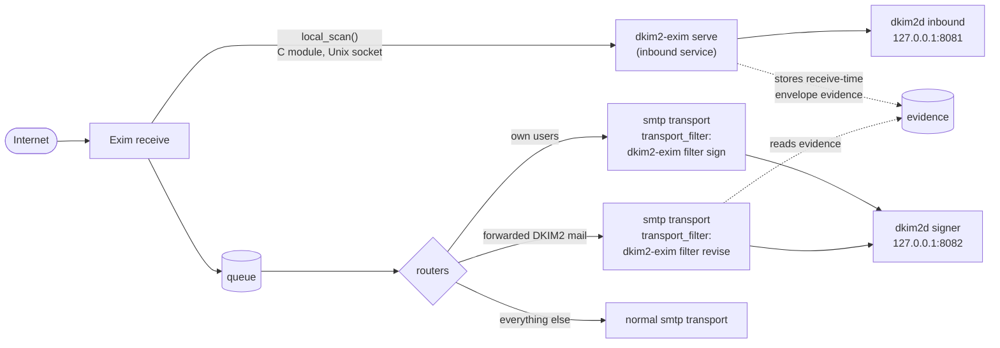
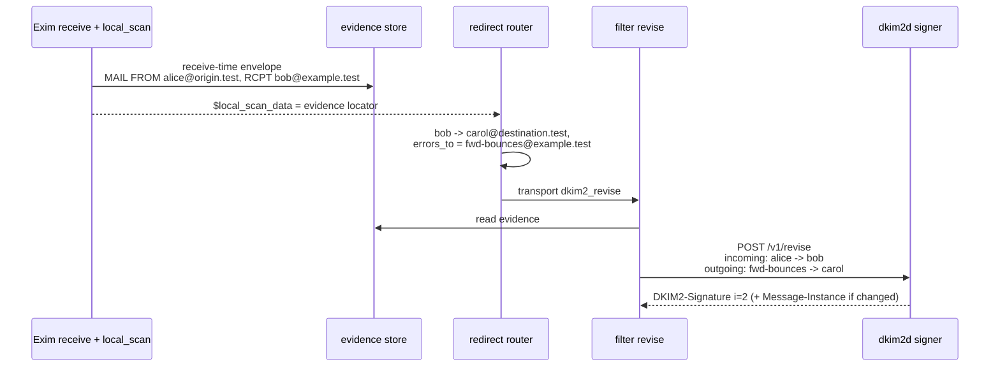

# Exim Step by Step

This guide adds DKIM2 to an Exim server, one use case at a time. The DKIM2
side is the same as for Postfix: an inbound `dkim2d` without keys and a
signer `dkim2d` with keys. Only the adapter differs. Read
[DKIM2 explained](dkim2-explained.md), [How dkim2d works](dkim2d-explained.md),
and [Keys and DNS](keys-and-dns.md) first.

> **Status.** The Exim adapter is implemented, but its capability is
> `unqualified_draft09`: the five-row real-Exim matrix has not yet been run
> against Draft-09. Treat this as a staging setup until that qualification
> exists. Operational details are in
> [Exim operations](../operations/exim-adapter.md).

## How Exim talks to DKIM2

Exim has no Milter interface, so the adapter `dkim2-exim` uses two Exim
hooks:



| Hook | Runs | Job |
| --- | --- | --- |
| `local_scan()` | once per received message, inside Exim | Verify, add `Authentication-Results`, accept, defer, or reject. Stores the receive-time envelope for later forwarding. |
| `transport_filter` | once per delivery, as a short-lived command | Read the complete message on stdin, ask `dkim2d` to sign or revise, write the signed message on stdout. |

Two facts shape the whole setup:

- **Exim must be rebuilt.** `local_scan()` is compiled into Exim. You build
  your distribution's Exim source package with the DKIM2 C module and a
  small patch that makes the outgoing return path available to the filter.
  A stock Exim binary works for neither inbound nor outbound DKIM2.
- **Everything runs as the Exim user.** The service, both filters, and all
  adapter files belong to the Exim account (`Debian-exim` on Debian and
  Ubuntu, `exim` on a source installation).

| Use case | Exim | Section |
| --- | --- | --- |
| Inbound verification | `local_scan` service | [A](#use-case-a-inbound-verification) |
| Outbound signing | `filter sign` | [B](#use-case-b-outbound-signing) |
| Forwarding | `filter revise` | [C](#use-case-c-forwarding) |
| Bounces and auto-replies | Exim-generated bounces and `<>` mail leave unsigned | [D](#use-case-d-bounces-and-auto-replies) |

## 0. Prepare the host

### Build Exim with the DKIM2 module

The supported source packages are pinned under
`cmd/dkim2-exim/exim/fixtures/` (upstream 4.99.5, Debian 13, Ubuntu 26.04).
For Debian the steps are:

1. Fetch the exact source package named in the row's
   `source-manifest-v1.txt` and verify its signature and checksums.
2. Apply `cmd/dkim2-exim/packaging/exim/dkim2-transport-filter-return-path.patch`
   with `patch -p1`, then the row's `local_scan.patch`.
3. Stage `cmd/dkim2-exim/packaging/exim/Local.Makefile`,
   `cmd/dkim2-exim/exim/dkim2_local_scan.c`, and the row's
   `build-id-v1.h`, then build the package with the normal toolchain.
4. Confirm the DKIM2 options exist: `exim4 -bP local_scan` lists
   `dkim2_socket`, `dkim2_spool_format`, and `dkim2_timeout`.

The full procedure is in
[`cmd/dkim2-exim/packaging/debian/README.md`](../../cmd/dkim2-exim/packaging/debian/README.md)
and [Exim packaging](../development/exim-packaging.md). The build ID of your
row is the hex string in its `build-id-v1.h`; you need it for the inbound
configuration.

### Build the Go programs

```sh
git clone https://github.com/croessner/dkim2.git
cd dkim2
for p in dkim2d dkim2-exim dkim2-dsn-propagator dkim2ctl; do
  GOFLAGS=-mod=vendor GOPROXY=off CGO_ENABLED=0 GOOS=linux GOARCH=amd64 \
    go build -trimpath -o "bin/$p" "./cmd/$p"
done
install -m 0755 bin/dkim2d bin/dkim2-dsn-propagator bin/dkim2ctl /usr/local/sbin/
install -m 0755 bin/dkim2-exim /usr/libexec/dkim2-exim
```

The build uses only the checked-in `vendor/` tree (`-mod=vendor`) and no
network (`GOPROXY=off`); see the
[Postfix guide](postfix-quickstart.md#build-the-programs) for details.

### Users and directories

The two `dkim2d` daemons run as their own user, exactly as in the
[Postfix guide](postfix-quickstart.md#users-groups-directories):

```sh
useradd --system --home-dir /nonexistent --shell /usr/sbin/nologin dkim2d
install -d -o root   -g root   -m 0755 /etc/dkim2 /var/lib/dkim2
install -d -o dkim2d -g dkim2d -m 0700 /var/lib/dkim2/inbound /var/lib/dkim2/signer
```

The Exim adapter's files belong to the Exim user. Each secret gets its own
directory with mode `0500`:

```sh
E=Debian-exim
install -d -o $E -g $E -m 0700 /etc/dkim2/process-secret /etc/dkim2/sign-secret \
  /etc/dkim2/revise-secret /etc/dkim2/evidence-secret
install -d -o $E -g $E -m 0700 /var/lib/dkim2-exim/evidence
```

Set the numeric Exim UID for the service:

```sh
echo "DKIM2_EXIM_UID=$(id -u Debian-exim)" > /etc/default/dkim2-exim
```

### The two daemons

Set up both daemons exactly as for Postfix:

- the inbound daemon: [Postfix guide A1 and A2](postfix-quickstart.md#a1-protected-generation-for-the-inbound-daemon),
  with `policy.mode: testing`;
- the signer daemon: [Keys and DNS](keys-and-dns.md) sections 1 to 6 and
  [Postfix guide B1](postfix-quickstart.md#b1-keys-dns-signer-daemon).

Start them with the `dkim2d@.service` unit from the Postfix guide:
`systemctl enable --now dkim2d@inbound dkim2d@signer`.

## Use case A: Inbound verification

### A1. Secrets for the adapter

```sh
E=Debian-exim
install -o $E -g $E -m 0400 /var/lib/dkim2/inbound/<GEN>/process.cap /etc/dkim2/process-secret/process.cap
openssl rand 32 > /etc/dkim2/evidence-secret/evidence.key   # evidence integrity key
chown $E:$E /etc/dkim2/evidence-secret/evidence.key; chmod 0400 /etc/dkim2/evidence-secret/evidence.key
chmod 0500 /etc/dkim2/process-secret /etc/dkim2/evidence-secret
```

### A2. `/etc/dkim2/exim.yaml`

Owner `Debian-exim`, mode `0400`. Put your row's build ID into
`allowed_build_ids`.

```yaml
version: dkim2-exim-config-v1
inbound:
  socket: /run/dkim2-exim/local-scan.sock
  socket_mode: "0600"
  peer_uid: ${DKIM2_EXIM_UID}
  allowed_build_ids:
    - <64-hex build ID from build-id-v1.h>
  request_timeout: 3s
  max_connections: 128
  max_in_flight_messages: 64
  max_buffered_bytes: 268435456
daemon:
  endpoint: http://127.0.0.1:8081
  process_capability_file: /etc/dkim2/process-secret/process.cap
  request_timeout: 2s
authentication_results:
  enabled: true
  authserv_id: mx.example.test
failure:
  inbound: tempfail
evidence:
  enabled: true                      # needed for forwarding (use case C)
  root: /var/lib/dkim2-exim/evidence
  key_file: /etc/dkim2/evidence-secret/evidence.key
  readiness_file: /run/dkim2-exim-readiness/state
  retention: 14d
  max_records: 100000
  max_bytes: 536870912
limits:
  message_bytes: 33554432
  header_bytes: 1048576
  header_count: 2000
  header_field_bytes: 65536
  recipient_count: 2000
observability:
  logging:
    level: info
    destination: stderr
  metrics:
    endpoint: 127.0.0.1:9465
```

### A3. Start the service

Install the packaged unit and the distribution drop-in:

```sh
install -m 0644 cmd/dkim2-exim/packaging/systemd/dkim2-exim.service /etc/systemd/system/
install -d /etc/systemd/system/dkim2-exim.service.d
install -m 0644 cmd/dkim2-exim/packaging/systemd/debian.conf \
  /etc/systemd/system/dkim2-exim.service.d/user.conf
systemctl daemon-reload
systemctl enable --now dkim2-exim
```

### A4. Exim main configuration

```text
# Required: Exim must keep the representation the adapter expects.
spool_wireformat = false
local_scan_timeout = 12s

begin local_scan
dkim2_spool_format = unix_lf
dkim2_socket = /run/dkim2-exim/local-scan.sock
dkim2_timeout = 11s
```

On Debian with split configuration, put the main options into a main
configuration fragment and the `begin local_scan` block at the end of the
generated configuration. Restart Exim and send yourself a test message; it
arrives with `Authentication-Results: mx.example.test; dkim2=none` or
`dkim2=pass`.

Outcomes map as follows: `reject` becomes a permanent SMTP rejection,
`tempfail` and every adapter problem a temporary one. Move `policy.mode` of
the inbound daemon from `testing` to `permissive` or `strict` when your
reports look right.

## Use case B: Outbound signing

### Why a transport filter, and why one recipient

The transport filter signs the message exactly as Exim sends it, with the
current return path and recipient. DKIM2 signs the envelope, and this
implementation signs one recipient per copy so Bcc recipients are never
revealed. `max_rcpt = 1` on the transport makes Exim deliver one recipient
per SMTP transaction.

### B1. Secret and configuration

```sh
install -o Debian-exim -g Debian-exim -m 0400 \
  /var/lib/dkim2/signer/<GEN>/sign.cap /etc/dkim2/sign-secret/sign.cap
chmod 0500 /etc/dkim2/sign-secret
```

`/etc/dkim2/sign.yaml` (owner `Debian-exim`, mode `0400`):

```yaml
version: dkim2-exim-config-v1
daemon:
  endpoint: http://127.0.0.1:8082
  sign_capability_file: /etc/dkim2/sign-secret/sign.cap
  request_timeout: 2s
signing:
  tenant: main
  domain: example.test
limits:
  message_bytes: 33554432
  header_bytes: 1048576
  header_count: 2000
  header_field_bytes: 65536
  recipient_count: 1
observability:
  logging:
    level: info
    destination: none
```

The signing domain is fixed per configuration. For a second domain, create a
second YAML file and a second transport.

### B2. Transport and router

```text
begin routers

# Sign mail from our own users and local programs for example.test.
dkim2_outbound:
  driver = dnslookup
  domains = ! +local_domains
  condition = ${if and{ \
      {!eq{$sender_address}{}} \
      {eq{$sender_address_domain}{example.test}} \
      {or{{def:authenticated_id}{match{$received_protocol}{\N^local\N}}}} \
    }}
  transport = dkim2_sign
  no_more

# ... your existing routers follow

begin transports

dkim2_sign:
  driver = smtp
  transport_filter = /usr/libexec/dkim2-exim --config /etc/dkim2/sign.yaml filter sign -- '$dkim2_transport_filter_return_path' '$pipe_addresses'
  max_rcpt = 1
  size_addition = -1
  transport_filter_timeout = 11s
  user = Debian-exim
  group = Debian-exim
```

| Setting | Reason |
| --- | --- |
| `condition` with `authenticated_id` / `local` | Sign only what your users or local programs submitted, never inbound mail that is merely forwarded. |
| `!eq{$sender_address}{}` | Bounces and auto-replies (`<>`) are not signed by this filter; see use case D. |
| `$dkim2_transport_filter_return_path` | The outgoing return path, provided by the Exim patch. Never use `$sender_address` here. |
| `max_rcpt = 1` | One recipient per signed copy. |
| `size_addition = -1` | The filter makes the message larger; Exim must not announce a precomputed `SIZE`. |
| no `headers_add`, `headers_remove`, `return_path` on this transport | Anything that changes the message after the filter breaks the signature. The deployment validator rejects it. |

The filter is silent: on any problem it writes nothing and exits with 75,
and Exim defers the delivery. Nothing unsigned leaves through this
transport.

### B3. Validate and check

```sh
cmd/dkim2-exim/packaging/validate-deployment.sh
```

The validator inspects the rendered Exim configuration (`exim -bP`) for every
setting that could change signed bytes. Then send a message to an external
mailbox and check it with [dkim2.pub](https://dkim2.pub).

## Use case C: Forwarding

Exim can forward DKIM2 mail properly, because the inbound service stored the
envelope the message arrived with, and the revise filter sends both
envelopes to `dkim2d`.



Why `errors_to`: DKIM2's chain of custody requires that the forwarding hop
sends **from** a domain the previous hop sent **to**. The previous hop sent to
`bob@example.test`, so your forwarded copy must leave with a return path in
`example.test` (see [DKIM2 explained](dkim2-explained.md#forwarding-aliases-lists-relays)).
Bounces of the forwarded copy then come back to you.

### C1. Keys and configuration

Forwarding uses its own keys and the datasource use `ordinary_transit`. Add
to the signer generation (build a new one, as in
[Keys and DNS](keys-and-dns.md)): two keys with selectors such as
`fwd-rsa-2026a` and `fwd-ed-2026a`, a profile for them, a policy
`"use": "ordinary_transit"`, matching private-manifest entries, and a
capability `revise.cap`. Add `revise_capability_file` to
`/etc/dkim2/dkim2d-signer.yaml`, publish the DNS records, validate, and
restart.

```sh
install -o Debian-exim -g Debian-exim -m 0400 \
  /var/lib/dkim2/signer/<GEN>/revise.cap /etc/dkim2/revise-secret/revise.cap
chmod 0500 /etc/dkim2/revise-secret
```

`/etc/dkim2/revise.yaml`:

```yaml
version: dkim2-exim-config-v1
daemon:
  endpoint: http://127.0.0.1:8082
  revise_capability_file: /etc/dkim2/revise-secret/revise.cap
  request_timeout: 2s
signing:
  tenant: main
  domain: example.test
evidence:
  enabled: true
  root: /var/lib/dkim2-exim/evidence
  key_file: /etc/dkim2/evidence-secret/evidence.key
  readiness_file: /run/dkim2-exim-readiness/state
  retention: 14d
  max_records: 100000
  max_bytes: 536870912
limits:
  message_bytes: 33554432
  header_bytes: 1048576
  header_count: 2000
  header_field_bytes: 65536
  recipient_count: 1
observability:
  logging:
    level: info
    destination: none
```

### C2. Routers and transport

```text
begin routers

# Aliases that forward to external addresses, with our own return path.
forward_aliases:
  driver = redirect
  domains = +local_domains
  data = ${lookup{$local_part}lsearch{/etc/exim4/forwards}}
  errors_to = fwd-bounces@example.test

# Forwarded DKIM2 mail: revise. Must come before the normal dnslookup router.
dkim2_forward:
  driver = dnslookup
  domains = ! +local_domains
  condition = ${if and{ \
      {def:h_DKIM2-Signature:} \
      {!eq{$local_scan_data}{}} \
      {!eq{$sender_address}{}} \
    }}
  transport = dkim2_revise
  no_more

begin transports

dkim2_revise:
  driver = smtp
  transport_filter = /usr/libexec/dkim2-exim --config /etc/dkim2/revise.yaml filter revise -- '$local_scan_data' '$dkim2_transport_filter_return_path' '$pipe_addresses'
  max_rcpt = 1
  size_addition = -1
  transport_filter_timeout = 11s
  user = Debian-exim
  group = Debian-exim
```

Notes:

- Accept mail for `fwd-bounces@example.test`; that is where bounces of
  forwarded copies arrive (see use case D).
- A message without stored evidence cannot be revised, and the filter defers
  it instead of guessing. Keep `evidence.enabled: true` in `exim.yaml`.
- A forwarded message whose content was not changed gets only a new
  `DKIM2-Signature`; a changed one also gets a `Message-Instance` with a
  Recipe.

## Use case D: Bounces and auto-replies

| Mail | With Exim today |
| --- | --- |
| Bounces Exim generates (`MAIL FROM:<>`) | Leave unsigned, as before. Signing a bounce requires proof that the MTA generated it; the project implements that proof only for Postfix (`/v1/dsn/sign`). |
| Auto-replies and notifications with `MAIL FROM:<>` | Leave unsigned. The routers above exclude the null sender, so these messages use your normal transport. |
| Bounces for mail you forwarded (to `fwd-bounces@example.test`) | Can be passed back to the previous hop with `dkim2-dsn-propagator` over LMTP. This path is not qualified with Exim. |

The propagator is MTA-neutral. An Exim integration must meet the same three
requirements as Postfix: deliver mail for the reserved return-path address,
and only that, over LMTP with one recipient per transaction and without
address rewriting; provide a loopback re-injection listener that adds no
signature and does not change the message; and retry later than the
daemon's propagation lease. An LMTP transport for the first part looks like
this:

```text
begin routers
dkim2_bounces:
  driver = accept
  domains = example.test
  local_parts = fwd-bounces
  senders = :
  transport = dkim2_propagate
  no_more

begin transports
dkim2_propagate:
  driver = lmtp
  socket = /run/dkim2/propagation/lmtp.sock
  batch_max = 1
```

Read
[the requirements](../operator/postfix-compose.md#the-same-requirements-without-postfix-parameter-names)
and [`cmd/dkim2-dsn-propagator/README.md`](../../cmd/dkim2-dsn-propagator/README.md)
before enabling it.

## Upgrades and rollback

Upgrade the rebuilt Exim package and `dkim2-exim` together, because the C
module and the adapter check each other's build ID. Stop Exim first, then
upgrade, validate, start the DKIM2 service, and finally start Exim. Rollback
is the same in reverse with the previous package and configuration. Details:
[Exim operations](../operations/exim-adapter.md#upgrade-and-rollback).

## Troubleshooting

| Problem | Check |
| --- | --- |
| Every message deferred at receive time | `systemctl status dkim2-exim`, `/run/dkim2-exim/local-scan.sock` exists, `peer_uid` equals the Exim UID, the build ID matches your rebuilt Exim. |
| Outbound deliveries deferred, nothing in the log | The filter is silent by design. Run the deployment validator, check `journalctl -u dkim2d@signer`, and check that the DNS keys are visible. |
| Mail leaves unsigned | The router `condition` did not match (sender domain, authentication), or the domain has no active `originator` policy. |
| Forwarded mail deferred | No evidence for the message (received before the inbound service ran, or evidence disabled), or the return path is not in your domain. |
| Validator says `hash_mismatch` downstream | A router or transport option changes headers after the filter. |

For the daemon side, the [Postfix troubleshooting table](postfix-quickstart.md#troubleshooting)
applies unchanged.
