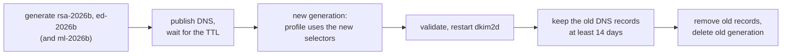

# Keys and DNS

This page takes you from "no keys" to "published, tested DNS records and a
signer that can use them". It uses the flat-file datasource, the simplest
backend, which fits a single server or a handful of domains. LDAP and SQL
backends follow the same ideas; their workflow is linked at the end.

Order matters: **generate, publish DNS, test DNS, then enable signing.**
`dkim2d` verifies every signature it creates against your public DNS record,
so signing fails until the record is visible.

## 1. Plan selectors and algorithms

A **selector** is the name of one key. Verifiers look the key up at
`<selector>._domainkey.<domain>`. Pick names that tell you what and when:

| Selector | Algorithm | Used for |
| --- | --- | --- |
| `rsa-2026a` | `rsa-sha256`, 2048 bits | outbound mail |
| `ed-2026a` | `ed25519-sha256` | outbound mail |
| `ml-2026a` | `mldsa44` | outbound mail (optional, see [step 7](#7-add-ml-dsa-44-later)) |
| `bounce-rsa-2026a` | `rsa-sha256` | bounces (only if you sign bounces) |
| `bounce-ed-2026a` | `ed25519-sha256` | bounces |

Recommendations:

- **Sign with RSA and Ed25519 together.** A profile with both keys produces
  one signature that needs both to verify. RSA keeps compatibility, Ed25519
  is small and fast. RSA keys must have at least 2048 bits.
- **ML-DSA-44 (`mldsa44`) is optional.** It is the post-quantum algorithm.
  Its DNS record is about 1,770 characters, which some DNS web interfaces
  cannot store. Add it later as a third key if you want it
  ([step 7](#7-add-ml-dsa-44-later)); verifiers that do not know it still
  pass with the RSA and Ed25519 group.
- **One key per job.** Keys for outbound mail (`originator`), forwarding
  (`ordinary_transit`), and bounces (`delivery_status`) must be different
  keys. The daemon refuses a datasource that binds one key to two uses.
- **One profile per domain.** Each domain you sign for gets its own keys and
  selectors.

## 2. Generate the keys

`dkim2d` has a built-in key generator. It writes the private key as a PEM
file with mode `0600`, never overwrites an existing file, and prints only
public material:

```sh
dkim2d datasource key generate --algorithm rsa-sha256 --rsa-bits 2048 \
  --domain example.test --selector rsa-2026a \
  --private-key /var/lib/dkim2/signer/<generation>/rsa-2026a.pem
```

Real output (the RSA key shortened):

```text
algorithm=rsa-sha256 domain=example.test selector=rsa-2026a
public_key_spki=MIIBIjANBgkqhkiG9w0BAQEFAAOCAQ8AMIIBCgKCAQEA08vjeLmk3qFc...
public_spki_sha256=S+HDCEGV5oj+/BqnZlXZ0cTv2wzYVhlT2MS6h54vbKE=
; dkim2-dns-export-v1
; ttl-seconds=3600
; algorithm=rsa-sha256 selector=rsa-2026a
rsa-2026a._domainkey.example.test. 3600 IN TXT "v=DKIM1; k=rsa; p=MIIBCgKCAQEA08vjeLmk..." "...IDAQAB"
```

| Output line | Where it goes |
| --- | --- |
| `public_key_spki=` | `datasource.json`, field `public_key_spki` of the credential |
| `public_spki_sha256=` | `private-keys.json`, field `public_spki_sha256` of the entry |
| the `TXT` line | your DNS zone |

Do not confuse the two public forms: `public_key_spki` (starts with `MIIBIj`
for RSA) is for the datasource, the DNS `p=` value (starts with `MIIBCg` for
RSA) is for DNS. Both describe the same key in different encodings. Copy each
value to its own place.

Ed25519 works the same way with `--algorithm ed25519-sha256` and produces a
short record:

```text
ed-2026a._domainkey.example.test. 3600 IN TXT "v=DKIM1; k=ed25519; p=NRzo7cyrLSlMRood+vafvxUdlr6VM67FZ6LFCUgO6AM="
```

`--ttl <seconds>` changes the TTL in the printed record. Use a short TTL
(300 to 3600) while you are setting things up.

## 3. Publish the DNS records

In a BIND-style zone file, paste the TXT lines as printed. Long RSA values
are already split into quoted strings of at most 255 characters; DNS joins
them.

In a web DNS interface, enter:

| Field | Value |
| --- | --- |
| Name / Host | `rsa-2026a._domainkey` (many interfaces add `.example.test` themselves) |
| Type | `TXT` |
| Value | `v=DKIM1; k=rsa; p=MIIBCgKCAQEA...` as one string, without the quotes between the parts |

Selector records may also be `CNAME`s into a central zone; the resolver
follows the chain.

## 4. Test the DNS records

From a machine that uses the same resolvers as your mail server:

```sh
dig +short TXT rsa-2026a._domainkey.example.test
dig +short TXT ed-2026a._domainkey.example.test
```

Check three things:

- The answer contains **exactly one** record starting with `v=DKIM1`. Two
  such records at one selector are a permanent error for every verifier.
- The `p=` value equals the one `key generate` printed (DNS may show it in
  several quoted parts).
- Wait at least the old TTL if you replaced a record; resolvers cache both
  positive and negative answers.

## 5. Optional: the Domain Policy Record

```text
_domainkey.example.test. 3600 IN TXT "v=DKIM1; f=strict"
```

Without this record, a signature from a subdomain such as
`d=news.example.test` may vouch for `From: alice@example.test`. With
`f=strict` it may not. Before publishing it, list every service that sends
mail with your From domain (newsletter tools, ticket systems, external
providers): if one of them signs with a subdomain key, its mail starts to
fail DKIM2. The record has no effect on signatures where `d=` equals the
From domain.

## 6. Build the signer's protected generation

The signer daemon reads its secrets from one sealed directory (see
[How dkim2d works](dkim2d-explained.md#the-protected-generation-secrets-in-one-sealed-folder)).
This script builds a complete generation for outbound signing of
`example.test`. Run it as root on the mail server:

```sh
#!/bin/sh
set -eu
umask 077

GEN=$(openssl rand -hex 16)                 # the generation name
DIR=/var/lib/dkim2/signer/$GEN              # secrets
OUT=/root/dkim2-public/$GEN                 # public output for DNS (not secret)
mkdir -p "$DIR" "$OUT"

# Route capabilities: 32 raw random bytes each.
openssl rand 32 > "$DIR/process.cap"        # required, given to no adapter here
openssl rand 32 > "$DIR/sign.cap"           # for the originator adapter

# Keys.
dkim2d datasource key generate --algorithm rsa-sha256 --rsa-bits 2048 \
  --domain example.test --selector rsa-2026a \
  --private-key "$DIR/rsa-2026a.pem" > "$OUT/rsa-2026a.txt"
dkim2d datasource key generate --algorithm ed25519-sha256 \
  --domain example.test --selector ed-2026a \
  --private-key "$DIR/ed-2026a.pem" > "$OUT/ed-2026a.txt"

value() { sed -n "s/^$1=//p" "$2"; }

cat > "$DIR/datasource.json" <<EOF
{
  "version": "dkim2-datasource-v1",
  "handles": [
    { "id": "example-rsa-2026a" },
    { "id": "example-ed-2026a" }
  ],
  "profiles": [
    {
      "id": "example-mail",
      "domain": "example.test",
      "status": "active",
      "credentials": [
        { "algorithm": "rsa-sha256", "selector": "rsa-2026a",
          "public_key_spki": "$(value public_key_spki "$OUT/rsa-2026a.txt")",
          "handle_id": "example-rsa-2026a" },
        { "algorithm": "ed25519-sha256", "selector": "ed-2026a",
          "public_key_spki": "$(value public_key_spki "$OUT/ed-2026a.txt")",
          "handle_id": "example-ed-2026a" }
      ]
    }
  ],
  "policies": [
    { "tenant_id": "main", "domain": "example.test", "use": "originator",
      "profile_id": "example-mail", "status": "active",
      "rollout": "enforce", "compatibility": "strict" }
  ]
}
EOF

cat > "$DIR/private-keys.json" <<EOF
{
  "version": "dkim2-private-keys-v1",
  "entries": [
    { "tenant_id": "main", "domain": "example.test", "use": "originator",
      "handle_id": "example-rsa-2026a", "algorithm": "rsa-sha256",
      "public_spki_sha256": "$(value public_spki_sha256 "$OUT/rsa-2026a.txt")",
      "private_key_file": "rsa-2026a.pem" },
    { "tenant_id": "main", "domain": "example.test", "use": "originator",
      "handle_id": "example-ed-2026a", "algorithm": "ed25519-sha256",
      "public_spki_sha256": "$(value public_spki_sha256 "$OUT/ed-2026a.txt")",
      "private_key_file": "ed-2026a.pem" }
  ]
}
EOF

chown -R dkim2d:dkim2d "$DIR"
chmod 0400 "$DIR"/*
chmod 0500 "$DIR"
echo "generation: $GEN"
grep -h ' IN TXT ' "$OUT"/*.txt             # publish these records
```

What the pieces mean:

- `tenant_id` groups domains administratively. A single organization uses
  one tenant, here `main`; the adapters name the same tenant.
- `status: active` and `rollout: enforce` make the policy live. An inactive
  or missing policy makes `/v1/sign` answer "not applicable", and the
  message leaves unsigned.
- Each private-manifest entry repeats tenant, domain, use, handle, and the
  public key hash, so a key file can never be used for anything else by
  accident.

Then put the printed generation name into the signer configuration
(`protected.generation` and the file paths) and check everything:

```sh
dkim2d validate --config /etc/dkim2/dkim2d-signer.yaml && echo OK
```

`validate` is silent on success and prints only a short error class on
failure. The most common causes are a wrong owner or mode, a capability file
that is not exactly 32 bytes, a value pasted into the wrong JSON field, and
one key bound to two uses.

## 7. Add ML-DSA-44 later

A profile holds at most three keys, one per algorithm. With ML-DSA-44 the
signer writes `s=` as `rsa,ed25519 | mldsa44`: the RSA and Ed25519 pair is
one group, ML-DSA-44 an alternative group (see the
[tag cheat sheet](tag-cheatsheet.md#how-several-algorithms-in-s-combine)).
Verifiers without ML-DSA keep passing with the pair. As long as the pair is
signed as well, ML-DSA-44 adds no protection against forgery yet; it
prepares the domain for the day the classical pair is dropped.

Generate the key. ML-DSA-44 has no size option:

```sh
dkim2d datasource key generate --algorithm mldsa44 \
  --domain example.test --selector ml-2026a \
  --private-key "$DIR/ml-2026a.pem" > "$OUT/ml-2026a.txt"
```

Real output (both keys shortened):

```text
algorithm=mldsa44 domain=example.test selector=ml-2026a
public_key_spki=MIIFMjALBglghkgBZQMEAxEDggUhAJ2ysDASLltVELvSjMU+lwN1...
public_spki_sha256=r3j+QAsWCx0qSnZcr6kxMoJWP3LMxOLzU6qjg+U2erw=
; dkim2-dns-export-v1
; ttl-seconds=3600
; algorithm=mldsa44 selector=ml-2026a
ml-2026a._domainkey.example.test. 3600 IN TXT "v=DKIM1; k=mldsa44; p=nbKwMBIuW1UQu9KMxT6X..." "..." "...wfJUKC6uwRA=="
```

The output lines go to the same places as for RSA and Ed25519. The
`public_key_spki` value starts with `MIIFMj`; the DNS `p=` value is the raw
1,312-byte key in Base64 (1,752 characters) and has no common prefix. The
private key file holds only the 32-byte seed. DNS-02 defines no key type for
ML-DSA-44 yet; `k=mldsa44` is the form this implementation and
`opendkim-manage-go` use (see
[Known limitations](../reference/known-limitations.md#post-quantum-algorithms)).

Publish the DNS record before the generation uses it:

- In a zone file, paste the TXT line as printed. It is split into nine
  quoted strings of at most 255 characters.
- In a web DNS interface, enter the value as one string of about 1,770
  characters. If the interface truncates it or refuses it, use a `CNAME`
  from `ml-2026a._domainkey.example.test` into a zone you manage as a file.
- Test it as in [step 4](#4-test-the-dns-records):
  `dig +short TXT ml-2026a._domainkey.example.test`. The joined `p=` value
  must be complete; a cut-off key cannot verify any signature.

Then build a new generation with the script from step 6, extended by:

- the `key generate` call above;
- in `datasource.json`: a third handle `{ "id": "example-ml-2026a" }` and a
  third credential, which must come **last** in `credentials` (order
  `rsa-sha256`, `ed25519-sha256`, `mldsa44`), inside the `datasource.json`
  heredoc of the script:

  ```text
  { "algorithm": "mldsa44", "selector": "ml-2026a",
    "public_key_spki": "$(value public_key_spki "$OUT/ml-2026a.txt")",
    "handle_id": "example-ml-2026a" }
  ```

- in `private-keys.json`: a third entry with `"handle_id": "example-ml-2026a"`,
  `"algorithm": "mldsa44"`, the `public_spki_sha256` from `ml-2026a.txt`,
  and `"private_key_file": "ml-2026a.pem"`.

Run `dkim2d validate` and restart `dkim2d` as in step 6. With LDAP no schema
change is needed. PostgreSQL, MySQL, and MariaDB need the forward migration
`010_mldsa44_algorithm.sql` first; see
[Datasource backends](../operator/datasource-backends.md#ml-dsa-44-credentials).
A `dkim2d` built against the FIPS 140-3 Go Cryptographic Module v1.0.0 has
no ML-DSA; `dkim2d serve` and `dkim2d validate` refuse to start in that
build.

## 8. Add bounce keys later

To sign bounces (Postfix only, see the
[Postfix guide](postfix-quickstart.md#use-case-e-bounces)), generate two more
keys with the `bounce-` selectors, publish their DNS records, and build a new
generation that additionally contains:

- in `datasource.json`: two more handles, a second profile `example-bounces`
  with the bounce credentials, and a policy with `"use": "delivery_status"`
  pointing to it;
- in `private-keys.json`: two entries with `"use": "delivery_status"`;
- a third capability `dsn-sign.cap`.

## 9. Rotate keys

Keys are rotated by publishing new ones *before* using them and removing old
ones *long after*. With ML-DSA-44, rotate `ml-2026a` to `ml-2026b` in the
same step:



Keep old records for at least 14 days, because signatures stay valid that
long and forwarded messages are verified again at every hop. Keep the old
generation directory until then too; pointing the YAML back at it is your
rollback. The full runbook for all backends is
[Key rotation](../operator/datasource-key-rotation.md).

## More domains, LDAP, and SQL

- More domains: add one profile and one policy per domain, with their own
  keys and selectors.
- Many domains or several servers: use LDAP, PostgreSQL, MySQL, or MariaDB
  with the offline `dkim2d datasource domain plan|prepare|dns export|prove|activate`
  workflow, which also exports and proves DNS records for you:
  [Native domain onboarding](../operator/native-domain-onboarding.md) and
  [Datasource backends](../operator/datasource-backends.md).
- Coming from OpenDKIM: [OpenDKIM migration](../operator/opendkim-migration.md)
  imports existing keys.
