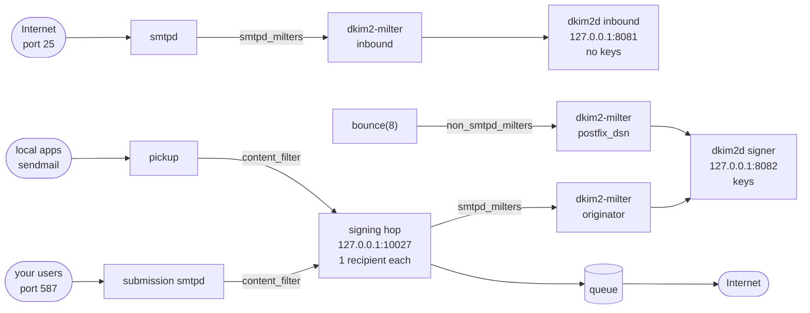
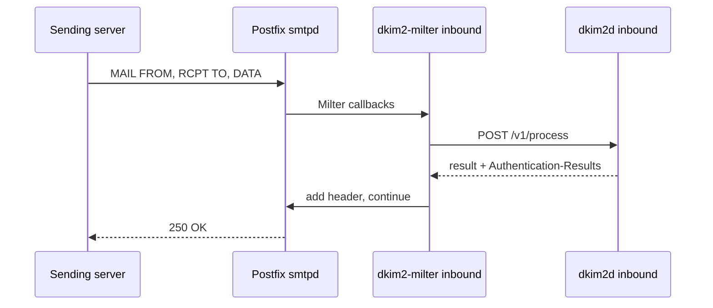
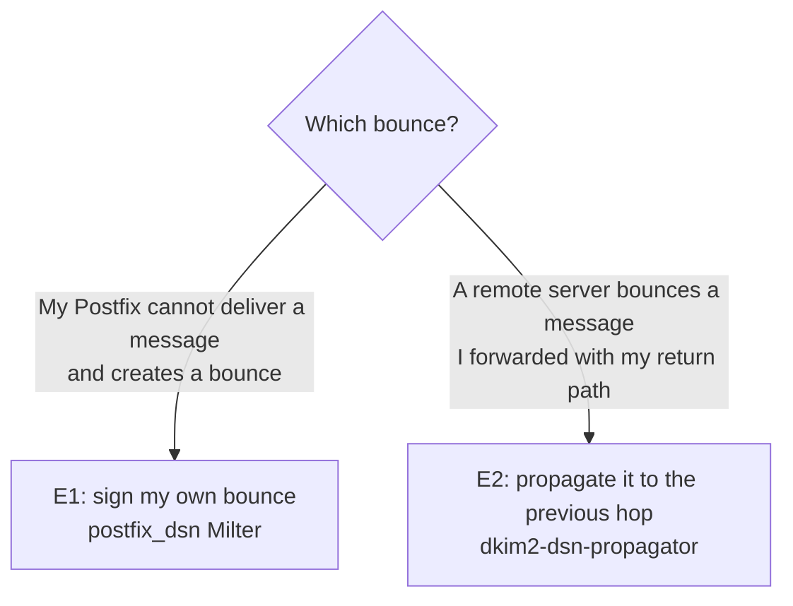

# Postfix Step by Step

This guide adds DKIM2 to an existing Postfix server, one use case at a time.
You keep your current setup (SPF, DKIM, DMARC, spam filter) and add DKIM2
next to it. Every configuration file shown here was checked with
`dkim2d validate` or `dkim2-milter validate`; paths, names, and ports are
suggestions you may change consistently.

Before you start, read [DKIM2 explained](dkim2-explained.md) and
[How dkim2d works](dkim2d-explained.md). Keys and DNS are covered in
[Keys and DNS](keys-and-dns.md).

> The project qualifies the hardened container deployment described in
> [`postfix-compose.md`](../operator/postfix-compose.md). This page shows the
> same building blocks on a classic host installation with systemd. Test it
> on a staging system before you put it in front of real mail.

## What you are going to build



- One **inbound daemon** without keys verifies mail from the Internet.
- One **signer daemon** with keys signs your outbound mail and, later, your
  bounces.
- One Milter process per job, each with its own socket and capability.
- A small **signing hop**: Postfix sends outbound mail through a loopback
  `smtpd` that carries the signing Milter, one recipient per transaction.

| Use case | Section | Needs |
| --- | --- | --- |
| A. Inbound verification | [A](#use-case-a-inbound-verification) | inbound daemon and Milter |
| B. Outbound signing | [B](#use-case-b-outbound-signing) | keys in DNS, signer daemon, originator Milter |
| C. Auto-replies | [C](#use-case-c-auto-replies-and-other-null-sender-mail) | B plus one option |
| D. Forwarding | [D](#use-case-d-forwarding) | read before you forward mail |
| E. Bounces | [E](#use-case-e-bounces) | Postfix with the internal-origin macro |

## 0. Prepare the host

### Build the programs

You need Go 1.27.3. Build Linux binaries from a checkout of a release tag:

```sh
git clone https://github.com/croessner/dkim2.git
cd dkim2
for p in dkim2d dkim2-milter dkim2-dsn-propagator dkim2ctl; do
  GOFLAGS=-mod=vendor GOPROXY=off CGO_ENABLED=0 GOOS=linux GOARCH=amd64 \
    go build -trimpath -o "bin/$p" "./cmd/$p"
done
install -m 0755 bin/* /usr/local/sbin/
```

All third-party Go modules are checked in under `vendor/`. `-mod=vendor`
builds from that tree only, and `GOPROXY=off` proves that nothing is
downloaded: the build works on an offline machine and uses exactly the
dependency sources of the release build. Use `GOARCH=arm64` for ARM servers.

`make product-binaries` builds the reproducible release binaries for amd64
and arm64 into `.artifacts/product-binaries/`. Container images are described
in [Container supply chain](../operator/container-supply-chain.md).

### Users, groups, directories

```sh
useradd --system --home-dir /nonexistent --shell /usr/sbin/nologin dkim2d
useradd --system --home-dir /nonexistent --shell /usr/sbin/nologin dkim2milter
groupadd --system dkim2sock          # who may connect to the Milter sockets
usermod -a -G dkim2sock postfix

install -d -o root   -g root   -m 0755 /etc/dkim2 /var/lib/dkim2
install -d -o dkim2d -g dkim2d -m 0700 /var/lib/dkim2/inbound /var/lib/dkim2/signer
install -d -o root   -g root   -m 0755 /etc/dkim2/milter
```

| Who | Owns | Why |
| --- | --- | --- |
| `dkim2d` | daemon YAML files, `/var/lib/dkim2/*` (keys, capabilities) | Only the daemon reads keys. |
| `dkim2milter` | Milter YAML files and their capability copies | Adapters never see keys. |
| `dkim2sock` | the Milter sockets (mode `0660`) | Postfix connects through group membership. |

### systemd units

These template units start one instance per configuration file. They are
examples; adapt hardening options to your distribution.

`/etc/systemd/system/dkim2d@.service`:

```ini
[Unit]
Description=DKIM2 daemon (%i)
After=network-online.target
Wants=network-online.target

[Service]
User=dkim2d
Group=dkim2d
ExecStartPre=/usr/local/sbin/dkim2d validate --config /etc/dkim2/dkim2d-%i.yaml
ExecStart=/usr/local/sbin/dkim2d serve --config /etc/dkim2/dkim2d-%i.yaml
Restart=on-failure
NoNewPrivileges=yes
PrivateTmp=yes
ProtectSystem=strict
ProtectHome=yes

[Install]
WantedBy=multi-user.target
```

`/etc/systemd/system/dkim2-milter@.service`:

```ini
[Unit]
Description=DKIM2 Milter (%i)
After=dkim2d@inbound.service dkim2d@signer.service

[Service]
User=dkim2milter
Group=dkim2sock
RuntimeDirectory=dkim2/%i
RuntimeDirectoryMode=0750
ExecStartPre=/usr/local/sbin/dkim2-milter validate --config /etc/dkim2/milter/%i.yaml
ExecStart=/usr/local/sbin/dkim2-milter serve --config /etc/dkim2/milter/%i.yaml
Restart=on-failure
NoNewPrivileges=yes
PrivateTmp=yes
ProtectSystem=strict
ProtectHome=yes

[Install]
WantedBy=multi-user.target
```

`RuntimeDirectory` creates `/run/dkim2/<instance>/` owned by `dkim2milter`
and group `dkim2sock`; the Milter creates its socket inside.

### Postfix chroot

Many distributions run `smtpd`, `cleanup`, and `pickup` chrooted to
`/var/spool/postfix`. Inside a chroot, `unix:/run/dkim2/...` points to
`/var/spool/postfix/run/dkim2/...`, and Postfix cannot find the socket. Check
the chroot column with `postconf -M` and set it to `n` for the services that
talk to DKIM2 (the project's reference configuration runs without chroot):

```sh
postconf -Fe 'smtp/inet/chroot=n' 'cleanup/unix/chroot=n' 'pickup/unix/chroot=n'
```

Any service you add below is configured with chroot `n`.

### Milter defaults in `main.cf`

```text
milter_protocol = 6
milter_default_action = tempfail
milter_connect_timeout = 2s
milter_command_timeout = 5s
milter_content_timeout = 30s
```

`milter_default_action = tempfail` is the safe choice: if a DKIM2 component
is down, mail waits in the sender's queue instead of passing unchecked.
Start the DKIM2 services before you reload Postfix. Size the content timeout
for your largest messages with [Message sizing](../operator/message-size.md).

## Use case A: Inbound verification

Goal: every message from the Internet is verified and gets an
`Authentication-Results: mx.example.test; dkim2=...` header. In `testing`
mode nothing is rejected.



### A1. Protected generation for the inbound daemon

```sh
umask 077
GEN=$(openssl rand -hex 16)
DIR=/var/lib/dkim2/inbound/$GEN
mkdir "$DIR"
openssl rand 32 > "$DIR/process.cap"     # route capability
openssl rand 32 > "$DIR/replay.hmac"     # replay store key
chown -R dkim2d:dkim2d "$DIR"; chmod 0400 "$DIR"/*; chmod 0500 "$DIR"
echo "$GEN"
```

### A2. `/etc/dkim2/dkim2d-inbound.yaml`

Replace `<GEN>` with the printed generation, then
`chown dkim2d:dkim2d` and `chmod 0400` the file.

```yaml
config:
  version: dkim2d-config-v1
protected:
  generation: <GEN>
server:
  listen: 127.0.0.1:8081
  capability_file: /var/lib/dkim2/inbound/<GEN>/process.cap
policy:
  mode: testing            # observe first; later permissive or strict
replay:
  backend: memory          # one MX; use redis for several MX servers
  hmac_key_file: /var/lib/dkim2/inbound/<GEN>/replay.hmac
  epoch: 1
```

### A3. The inbound Milter

Give the Milter its own copy of the process capability:

```sh
install -d -o dkim2milter -g dkim2milter -m 0700 /etc/dkim2/milter/inbound
install -o dkim2milter -g dkim2milter -m 0400 \
  /var/lib/dkim2/inbound/<GEN>/process.cap /etc/dkim2/milter/inbound/capability
chmod 0500 /etc/dkim2/milter/inbound
```

`/etc/dkim2/milter/inbound.yaml` (owner `dkim2milter`, mode `0400`):

```yaml
version: dkim2-milter-config-v1
server:
  socket: /run/dkim2/inbound/milter.sock
  socket_mode: "0660"
  shutdown_timeout: 10s
  max_connections: 128
  max_in_flight_messages: 64
  max_buffered_bytes: 268435456
daemon:
  endpoint: http://127.0.0.1:8081
  capability_file: /etc/dkim2/milter/inbound/capability
  request_timeout: 5s
mode: inbound
authentication_results:
  enabled: true
  authserv_id: mx.example.test     # your MX host name, lowercase
failure:
  mode: tempfail
limits:
  message_bytes: 33554432
  header_bytes: 1048576
  header_count: 2000
  header_field_bytes: 65536
  recipient_count: 2000
observability:
  logging:
    level: info
```

`authserv_id` is the name in your `Authentication-Results` headers. The
Milter removes forged headers claiming the same name before it adds its own.

### A4. Start and connect Postfix

```sh
systemctl enable --now dkim2d@inbound dkim2-milter@inbound
curl -s -o /dev/null -w '%{http_code}\n' http://127.0.0.1:8081/readyz   # 200
postconf -e 'smtpd_milters = unix:/run/dkim2/inbound/milter.sock'
postfix reload
```

If you already have Milters, list them together:
`smtpd_milters = unix:/run/dkim2/inbound/milter.sock, inet:127.0.0.1:8891`.

### A5. Check it

Send yourself a message from an external account and look at the headers:

```text
Authentication-Results: mx.example.test; dkim2=none
```

`none` is normal: most senders do not use DKIM2 yet. A DKIM2 test message,
for example from [dkim2.pub](https://dkim2.pub), shows `dkim2=pass`. The
daemon's metrics show the overall picture:

```sh
curl -s http://127.0.0.1:8081/metrics | grep '^dkim2d_process'
```

When the results look right for a while, switch `policy.mode` to
`permissive` (reject nothing, but treat results as final) or `strict`
(reject `FAIL` and `PERMERROR`) and restart `dkim2d@inbound`.

## Use case B: Outbound signing

Goal: mail your users and local applications send leaves with
`Message-Instance` and `DKIM2-Signature`.

### Why a signing hop?

DKIM2 signs the envelope, and this implementation signs **one recipient per
copy** so Bcc recipients stay hidden (see
[DKIM2 explained](dkim2-explained.md#outbound-your-users-send-mail)). A user
who writes to five people sends one SMTP transaction with five `RCPT TO`. The
signing Milter refuses a second recipient, so Postfix must first split the
message. The classic Postfix content-filter pattern does exactly that:

```text
submission (587) --content_filter--> dkim2sign transport (recipient limit 1)
                                        |
                                        v
                         127.0.0.1:10027 smtpd + originator Milter
                                        |
                                        v
                              queue -> remote delivery
```

### B1. Keys, DNS, signer daemon

Follow [Keys and DNS](keys-and-dns.md) sections 1 to 6. At the end you have:

- published and tested DNS records for `rsa-2026a` and `ed-2026a`;
- a generation `/var/lib/dkim2/signer/<GEN>/` with `process.cap`,
  `sign.cap`, `datasource.json`, `private-keys.json`, and two PEM files.

`/etc/dkim2/dkim2d-signer.yaml` (owner `dkim2d`, mode `0400`):

```yaml
config:
  version: dkim2d-config-v1
protected:
  generation: <GEN>
server:
  listen: 127.0.0.1:8082
  capability_file: /var/lib/dkim2/signer/<GEN>/process.cap   # required, unused
  sign_capability_file: /var/lib/dkim2/signer/<GEN>/sign.cap
replay:
  backend: disabled
signing:
  backend: flat_file
  datasource_file: /var/lib/dkim2/signer/<GEN>/datasource.json
  private_manifest_file: /var/lib/dkim2/signer/<GEN>/private-keys.json
```

### B2. The originator Milter

```sh
install -d -o dkim2milter -g dkim2milter -m 0700 /etc/dkim2/milter/originator
install -o dkim2milter -g dkim2milter -m 0400 \
  /var/lib/dkim2/signer/<GEN>/sign.cap /etc/dkim2/milter/originator/capability
chmod 0500 /etc/dkim2/milter/originator
```

`/etc/dkim2/milter/originator.yaml`:

```yaml
version: dkim2-milter-config-v1
server:
  socket: /run/dkim2/originator/milter.sock
  socket_mode: "0660"
  shutdown_timeout: 10s
  max_connections: 128
  max_in_flight_messages: 64
  max_buffered_bytes: 268435456
daemon:
  endpoint: http://127.0.0.1:8082
  capability_file: /etc/dkim2/milter/originator/capability
  request_timeout: 5s
mode: originator
signing:
  tenant: main                       # the tenant_id of your datasource policies
  domain_source: envelope_sender     # sign for the MAIL FROM domain
  dsn_domain: example.test           # required placeholder, not used for signing
  allow_recipient_group: false
failure:
  mode: tempfail
limits:
  message_bytes: 33554432
  header_bytes: 1048576
  header_count: 2000
  header_field_bytes: 65536
  recipient_count: 1
observability:
  logging:
    level: info
```

`domain_source: envelope_sender` takes the signing domain from `MAIL FROM`.
One Milter therefore serves every domain in your datasource; a domain without
an active policy simply leaves unsigned. Use `domain: example.test` instead
for a fixed single domain.

### B3. Postfix: the signing hop

`main.cf`:

```text
dkim2sign_destination_recipient_limit = 1
```

`master.cf`: add the `dkim2sign` and `127.0.0.1:10027` entries, and add the
`-o` lines to your *existing* `submission` and `pickup` entries instead of
duplicating them (`postconf -Pe 'pickup/unix/content_filter=dkim2sign:[127.0.0.1]:10027'`
does that for `pickup`):

```text
submission inet n       -       n       -       -       smtpd
  -o syslog_name=postfix/submission
  -o smtpd_tls_security_level=encrypt
  -o smtpd_sasl_auth_enable=yes
  -o smtpd_client_restrictions=permit_sasl_authenticated,reject
  -o smtpd_milters=
  -o content_filter=dkim2sign:[127.0.0.1]:10027

pickup    unix  n       -       n       60      1       pickup
  -o content_filter=dkim2sign:[127.0.0.1]:10027

dkim2sign unix  -       -       n       -       -       smtp
  -o syslog_name=postfix/dkim2sign

127.0.0.1:10027 inet n  -       n       -       -       smtpd
  -o syslog_name=postfix/dkim2sign-in
  -o smtpd_milters=unix:/run/dkim2/originator/milter.sock
  -o non_smtpd_milters=
  -o content_filter=
  -o receive_override_options=no_address_mappings
  -o smtpd_client_restrictions=permit_mynetworks,reject
  -o smtpd_relay_restrictions=permit_mynetworks,reject
  -o mynetworks=127.0.0.0/8
```

What each part does:

| Line | Reason |
| --- | --- |
| `submission ... -o smtpd_milters=` | Your users' mail is not "inbound"; skip the inbound Milter. |
| `content_filter=dkim2sign:[127.0.0.1]:10027` | After the first queueing, deliver the mail to the signing hop instead of the Internet. |
| `pickup ... content_filter` | Same for local `sendmail` (web applications, cron). |
| `dkim2sign_destination_recipient_limit = 1` | Split into one recipient per transaction. |
| `127.0.0.1:10027 ... smtpd_milters=...originator` | The only listener with the signing Milter, reachable only from loopback. |
| `content_filter=` on the hop | Prevents a loop: signed mail goes to the normal queue. |
| `no_address_mappings` | Aliases and canonical maps already ran on the first pass; running them again could change the envelope after signing. |

Start and reload:

```sh
systemctl enable --now dkim2d@signer dkim2-milter@originator
postfix reload
```

### B4. Check it

Send a message to an external mailbox. Its headers start with:

```text
Message-Instance: m=1; h=sha256:...;
DKIM2-Signature: i=1; m=1; t=...; mf=...; rt=...; d=example.test;
	s=rsa-2026a:rsa-sha256:...,ed-2026a:ed25519-sha256:...;
```

Check it with a public validator such as [dkim2.pub](https://dkim2.pub) and
watch the Postfix log for `postfix/dkim2sign-in`.

| Symptom | Likely cause |
| --- | --- |
| Mail deferred with `451 4.7.1` from the hop | Daemon down, wrong capability copy, or DNS key missing (the signer verifies itself). Check `journalctl -u dkim2d@signer`. |
| Mail leaves unsigned | No active `originator` policy for that MAIL FROM domain, or the sender address is not ASCII. |
| Message from a vacation script stuck in the queue | Null sender; see use case C. |
| Validator says `hash_mismatch` | Something changed the message after signing: an `smtp_header_checks`, a footer tool on the outbound path, or a relay host that rewrites. |

Keep anything that rewrites headers or bodies *before* the signing hop. A
classic DKIM signer (OpenDKIM) may stay where it is: `DKIM-Signature` fields
are not part of the DKIM2 hash.

## Use case C: Auto-replies and other null-sender mail

Vacation replies (Sieve), read receipts, and notification mails use
`MAIL FROM:<>`. By default the originator Milter refuses to sign such mail
and defers it with `451`, because on an open listener a null sender is easy
to forge. Your signing hop is not open: only your own submission and pickup
reach it. There you may allow it.

Add to `/etc/dkim2/milter/originator.yaml`:

```yaml
signing:
  tenant: main
  domain_source: envelope_sender
  null_sender: header_from          # sign <> mail with the From domain
  dsn_domain: example.test
  allow_recipient_group: false
```

and to `/etc/dkim2/dkim2d-signer.yaml`:

```yaml
signing:
  policy:
    originator:
      null_sender: header_from
```

Both switches are required. The signing domain is then the domain of the
single `From` address, and the signature carries `mf=<>`. Real bounces
(`multipart/report` delivery-status messages) are never signed this way;
they pass unchanged and have their own path (use case E). Never enable
`null_sender: header_from` on a Milter that faces the Internet.

## Use case D: Forwarding

First answer the question from
[DKIM2 explained](dkim2-explained.md#forwarding-aliases-lists-relays): does
your forwarding change the envelope?

| Your setup | What happens with DKIM2 today | What to do |
| --- | --- | --- |
| Backup MX or relay that passes mail on unchanged (same MAIL FROM, same RCPT TO, same bytes) | The original signature still matches. | Nothing. Do not put a DKIM2 Milter on that path. |
| Inbound gateway that delivers to an internal mailbox server | Verification happens at the gateway (use case A). | Nothing more. |
| Alias, `virtual_alias_maps`, or `.forward` to an external address | The new `RCPT TO` no longer matches the signed `rt=`, so DKIM2 verifiers downstream see `FAIL`. Re-signing needs your own return path *and* both envelopes (before and after the alias). A Milter sees only one envelope. | Postfix has no ready-made component for this yet. Prefer local delivery, or integrate a two-envelope client of `POST /v1/revise` (see below). |
| Mailing list software | Same as an alias, plus content changes. | The list software or an integration must revise with a Recipe. |

The `ordinary_transit` Milter mode re-signs mail whose envelope does not
change. Because of the custody rule it fits only narrow topologies, for
example a relay inside one domain that must document a content change. It is
described in the [Postfix Compose guide](../operator/postfix-compose.md) and
the [deployment walkthrough](../operator/deployment-walkthrough.md#33-ordinary-transit-revision).

For real forwarding, an integration calls `POST /v1/revise` with the
envelope the message arrived with (`incoming_smtp`) and the envelope it
leaves with (`smtp`, with a return path in your domain), or
`POST /v1/revise/batch` for a complete fan-out. The project's qualification
tests do exactly that; the contract is in
[`docs/specs/openapi/dkim2d.yaml`](../specs/openapi/dkim2d.yaml) and
[batch revision](../specs/implementation/batch-revision.md). The current
limits are listed in [known limitations](../reference/known-limitations.md).

## Use case E: Bounces

There are two different bounce jobs. Do not mix them up.



### E1. Signing the bounces your Postfix generates

The difficulty is trust: anybody can send mail with `MAIL FROM:<>`. DKIM2
signs a bounce only when Postfix itself proves that its `bounce(8)` daemon
created it. Postfix passes that proof to Milters as the macro
`{postfix_internal_origin}`. It exists in upstream Postfix since
`postfix-3.12-20260915`; older versions need the backport described in the
[Postfix origin contract](../specs/implementation/postfix-dsn-origin.md).
Check your Postfix first: without the macro, this use case is not available
and bounces leave unsigned, as before.

A bounce is signed only for a domain that was a recipient of the bounced
message, and its `From` (`MAILER-DAEMON@$myorigin`) must lie in that domain.
Set `myorigin` to your main domain (or a subdomain of it).

1. Generate bounce keys and extend the signer generation as described in
   [Keys and DNS, section 8](keys-and-dns.md#8-add-bounce-keys-later): a
   `delivery_status` profile with its own keys, and `dsn-sign.cap`.
2. Add to `/etc/dkim2/dkim2d-signer.yaml`:

   ```yaml
   server:
     dsn_sign_capability_file: /var/lib/dkim2/signer/<GEN>/dsn-sign.cap
   signing:
     policy:
       delivery_status:
         unsigned_original: continue
   ```

   `unsigned_original: continue` lets bounces for mail *without* DKIM2 leave
   unsigned as classic bounces. Without it they are refused and stay in the
   queue, and the sender never learns about the failure. Keep it while you
   accept non-DKIM2 mail, which today means always.

3. `/etc/dkim2/milter/bounce.yaml`, with a copy of `dsn-sign.cap` in
   `/etc/dkim2/milter/bounce/capability` (owner `dkim2milter`, parent `0500`):

   ```yaml
   version: dkim2-milter-config-v1
   server:
     socket: /run/dkim2/bounce/milter.sock
     socket_mode: "0660"
     shutdown_timeout: 10s
     max_connections: 32
     max_in_flight_messages: 16
     max_buffered_bytes: 268435456
   daemon:
     endpoint: http://127.0.0.1:8082
     capability_file: /etc/dkim2/milter/bounce/capability
     request_timeout: 5s
   mode: postfix_dsn
   signing:
     tenant: main
     domain_source: verified_embedded
   failure:
     mode: tempfail
   limits:
     message_bytes: 33554432
     header_bytes: 1048576
     header_count: 2000
     header_field_bytes: 65536
     recipient_count: 1
   observability:
     logging:
       level: info
   ```

4. `main.cf`:

   ```text
   non_smtpd_milters = unix:/run/dkim2/bounce/milter.sock
   internal_mail_filter_classes = bounce
   ```

   `internal_mail_filter_classes = bounce` makes Postfix pass its own bounces
   through `non_smtpd_milters`; by default it does not. Local `sendmail` mail
   does not need `non_smtpd_milters` here, because `pickup` already uses the
   signing hop from use case B.

5. `systemctl enable --now dkim2-milter@bounce && postfix reload`.

Expect many bounces to stay unsigned: a bounce about a message you *sent* to
a remote recipient has no matching local recipient domain, so Draft-09
forbids signing it. The counter `dkim2d_dsn_unsigned_total` shows the reasons;
`delivery_status_from_not_authentic` means `myorigin` is not inside your
bounce profile domain. Details:
[DSN signing identity](../operator/postfix-compose.md#dsn-signing-identity).

### E2. Propagating bounces for forwarded mail

When you forward a message with a return path in your own domain, the
destination's bounce comes back to you. DKIM2 lets you rebuild it for the
previous hop. `dkim2-dsn-propagator` receives such bounces over LMTP, asks the
signer daemon to rebuild and sign them, and re-injects the result through a
loopback listener without any Milter.

This only applies once you forward mail with your own return path (use case
D). The complete configuration, including the reserved return-path address
class, the LMTP transport, the re-injection listener, and retry timing, is in
[Delivery-status propagation](../operator/postfix-compose.md#delivery-status-propagation)
and [`cmd/dkim2-dsn-propagator/README.md`](../../cmd/dkim2-dsn-propagator/README.md).
The Postfix part looks like this:

```text
# main.cf
transport_maps = inline:{ {bounces@example.test = dsn_propagator:unix:/run/dkim2/propagation/lmtp.sock} }
dsn_propagator_destination_recipient_limit = 1
minimal_backoff_time = 600s

# master.cf
dsn_propagator unix  -       -       n       -       -       lmtp
127.0.0.1:10025 inet n       -       n       -       -       smtpd
  -o smtpd_milters=
  -o non_smtpd_milters=
  -o content_filter=
  -o receive_override_options=no_address_mappings
  -o smtpd_client_restrictions=permit_mynetworks,reject
```

The signer daemon then also needs `dsn_propagate_capability_file`, a
`delivery_status` profile for the forwarding domain, and a `memory` or
`redis` replay store.

## Going to production

- [ ] DNS records published and tested; old records kept during rotation.
- [ ] Inbound in `testing` for a while, then `permissive` or `strict`.
- [ ] Every capability unique; no adapter holds a capability of another job.
- [ ] Outbound mail checked with an external validator after every filter.
- [ ] `milter_default_action = tempfail`; an outage test shows deferred, not
      accepted, mail.
- [ ] Several MX servers share a Redis or Valkey replay store
      ([replay store](../replay-store-redis.md)).
- [ ] Monitoring scrapes `/metrics` of every daemon; `/readyz` is alerted.
- [ ] A copy of every generation and YAML file is backed up; you know how to
      roll back.

The detailed decision list and acceptance matrix for experienced operators is
the [Postfix administrator guide](../operator/postfix-admin.md).

## Troubleshooting

| Problem | Check |
| --- | --- |
| `dkim2d validate` prints `runtime failure` | File owner and mode (`0400`/`0600`, generation `0500`), exact 32-byte capability files, generation name equals `protected.generation`, every file the YAML names exists and nothing else is a capability in the directory. |
| Postfix logs `can't connect to Milter` | Socket path vs. chroot, `postfix` in group `dkim2sock`, Milter running (`systemctl status dkim2-milter@inbound`). |
| Everything is deferred with `451 4.7.1` | A daemon is not ready (`curl 127.0.0.1:8081/readyz`) or a capability copy does not match the daemon's file. |
| Inbound always `dkim2=none` | Normal for mail without DKIM2. Test with a DKIM2 sender. |
| `dkim2=temperror` | DNS problems on the MX; check the resolver in `/etc/resolv.conf`. |
| Signing fails right after a key change | The new DNS record is not visible yet; the signer verifies itself through DNS. |

Raise `observability.logging.level: debug` in the affected YAML for more
events. Logs never contain addresses, keys, or message content, so they are
safe to share in a ticket.
