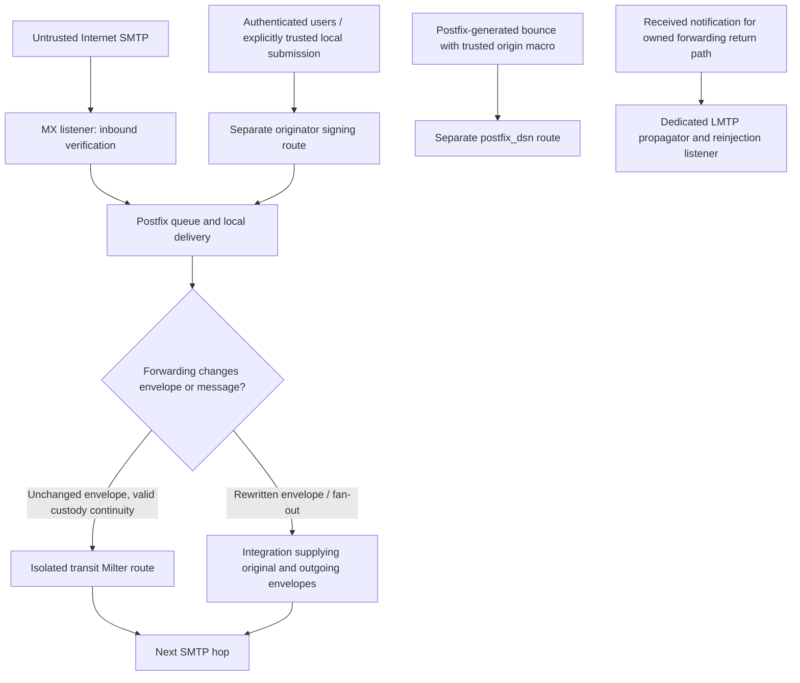

# Postfix and DKIM2: administrator's starting point

This guide connects the deployment procedure to the decisions an administrator
must make before accepting real mail. Read it alongside the
[deployment walkthrough](deployment-walkthrough.md), which explains verification,
signing, revision and delivery-status flows with sequence diagrams. The
[Postfix Compose guide](postfix-compose.md) owns the executable deployment steps
and exact protected-file contracts. Component READMEs own configuration schemas;
do not assemble a configuration from fragments taken from different releases.

The implementation uses `draft-ietf-dkim-dkim2-spec-08` and
`draft-ietf-dkim-dkim2-dns-02`. Installing newer build dependencies does not
change those protocol baselines. DKIM2 is still a draft protocol: retain your
existing DKIM/SPF/DMARC policy and qualify interoperability independently.

## Decide what this host is allowed to do

A route is an authorization boundary, not merely a different socket name.
Untrusted clients must never be able to choose the originator, transit or DSN
capability. `From`, `Authentication-Results`, `X-DKIM2-Info` and other supplied
headers cannot grant that authority. Plan these paths before provisioning keys:

| Traffic | Required decision | Why it matters |
| --- | --- | --- |
| Internet MX ingress | Inbound verification and explicit local acceptance policy | Verification must not turn arbitrary inbound mail into locally authorized originator mail. |
| User submission | Authentication, relay authorization and a dedicated signing listener | `non_smtpd_milters` does not sign SMTP submission merely because the client is local. |
| Local `sendmail`/pickup | Decide which local applications may originate mail | Non-SMTP filtering uses simulated callbacks, not an authenticated SMTP session. |
| Ordinary transit | Prove unchanged-envelope custody continuity | The transit Milter supplies the observed envelope as both inherited and outgoing envelope; it cannot recover a pre-rewrite envelope. |
| Alias expansion, SRS, mailing list or fan-out | Choose an integration that explicitly supplies both message/envelope states | A global transit Milter is not a general forwarding solution. See the walkthrough's revision flow. |
| Locally generated DSN | Dedicated capability and EOH-confirmed Postfix origin | A null sender alone does not establish trusted bounce provenance. |
| Received forwarding DSN | Explicit return-path routing to the propagator | Locally signing a bounce and propagating a received notification are different operations. |

The supplied Compose deployment is a controlled integration template, not a
complete hosted-mail product. Replace reserved `.test` identities, define your
accepted domains and recipients, and integrate your existing TLS, SASL,
anti-abuse and mailbox services. The base configuration does not provision
public submission authentication or a production certificate service. Audit
`mynetworks` explicitly; never trust an entire shared container network simply
because it is private.

## Follow the installation in dependency order

| Step | Authoritative procedure | Completion evidence |
| --- | --- | --- |
| 1. Select a matching release | [Container supply chain](container-supply-chain.md) | Record immutable daemon, adapter and Postfix image digests, supported platform and draft baseline. |
| 2. Choose signing storage | [Datasource backends](datasource-backends.md) | Validated flat-file generation or independently operated LDAP/SQL with verified TLS and least-privilege runtime identity. |
| 3. Provision domains and publish DNS | [Native onboarding](native-domain-onboarding.md), or [OpenDKIM migration](opendkim-migration.md) | Public key publication and DNS proof completed before activation; private keys stay in protected storage. Native onboarding applies to native LDAP/SQL providers. |
| 4. Choose replay policy | [Replay store](../replay-store-valkey.md) | Explicit disabled/memory/Valkey choice; documented restart/loss behavior. In-memory state does not provide durable shared replay detection. |
| 5. Provision protected route state | [Compose prerequisites](postfix-compose.md#host-and-protected-state-prerequisites) | Correct numeric owners, modes, immutable generations and separate route capabilities through the final mounts. |
| 6. Size the whole pipeline | [Message sizing](message-size.md) | Consistent Postfix, adapter, daemon and DSN limits, timeout budget and measured memory headroom. |
| 7. Validate and start | [Start and verify](postfix-compose.md#start-and-verify) | Daemons ready, adapters validated, sockets owned and reachable; only then start SMTP admission. |
| 8. Prove actual mailflow | Acceptance matrix below | Positive and negative SMTP tests plus independent cryptographic verification of the delivered message. |
| 9. Prepare operations | [Lifecycle and rollback](postfix-compose.md#shutdown-upgrade-and-rollback), [key rotation](datasource-key-rotation.md) | Restore drill, retained prior generation/digests, queue-preservation procedure and monitoring. |

DNS lookup success alone does not establish that the deployed signer uses the
matching key or that a downstream verifier sees the same message. Allow for
positive and negative DNS caching during activation and retirement. Use the
rotation runbook's overlap and retention rules; do not delete an old key simply
because the new selector resolves.

## Understand the important Postfix settings

The checked [`main.cf`](../../deployments/postfix-compose/postfix/main.cf) and
[`master.cf`](../../deployments/postfix-compose/postfix/master.cf) are the base
configuration. The DSN propagation overlay is separate. Inspect effective
service overrides as well as global settings; an override can select a different
Milter for one listener.

| Setting or boundary | Reason and operational consequence |
| --- | --- |
| `smtpd_milters` | Selects filtering for SMTP reception. Put inbound and authenticated originator traffic on separately classified services. |
| `non_smtpd_milters` | Covers non-SMTP intake such as pickup. SMTP mail is not passed through this list as a second signing stage. Locally generated notifications also require explicit Postfix filtering/provenance configuration described in the DSN runbook. |
| `milter_protocol = 6` | Negotiates the protocol used by the adapter; successful TCP/Unix connect alone does not prove action negotiation. |
| `milter_default_action = tempfail` | Postfix defers on communication/protocol failures instead of accepting mail without the required filter. This is separate from the daemon's explicit verification verdict or the adapter's policy. |
| `milter_connect_timeout`, `milter_command_timeout`, `milter_content_timeout` | Budget connection setup and callback work. The content timeout must leave room for admission wait, daemon processing and returning/applying actions; the base template's five-second content timeout is not suitable for every large-message profile. |
| `message_size_limit` | Bound the SMTP input together with adapter and daemon limits, including DSN growth. Raising only this value creates late rejections or excessive buffering. |
| Unix socket path and group | Postfix needs directory traversal and permission to connect. A read-only socket mount prevents filesystem mutation; it does not make the protocol read-only. |
| `master.cf` chroot column | A chroot changes the meaning of absolute socket paths. The checked services use no chroot; a distribution default may differ. Verify visibility from the actual Postfix process namespace. |
| Isolated transit listener | The reference binds `127.0.0.1:2526` inside the Postfix container. Container loopback is neither host loopback nor another container's loopback. |
| Relay restrictions | DKIM2 does not authorize SMTP relay. Retain destination and authenticated-submission restrictions; test an unauthorized relay attempt before exposure. |

The official [Postfix Milter guide](https://www.postfix.org/MILTER_README.html)
explains the two filter lists, callback simulation, chroot socket interpretation
and timeout behavior. Consult the [Postfix parameter reference](https://www.postfix.org/postconf.5.html)
for the installed Postfix version. Do not replace a restrictive policy with
`accept` to hide a socket, permission, provenance or daemon failure.

Order other filters deliberately. A later body/header rewrite can invalidate
an earlier signature. Test the complete chain including content filters,
address rewriting, reinjection and the final recipient transaction. An
`Authentication-Results` header is local reporting, not independent proof of
DKIM2 validity. The optional unsigned `X-DKIM2-Info` field is diagnostic only.

## Bounce and auto-reply details that must be decided explicitly

For local DSN signing, use the [Postfix origin contract](../specs/implementation/postfix-dsn-origin.md)
and the Compose guide's [origin migration](postfix-compose.md#upstream-postfix-origin-migration-v0131).
Version numbers alone are insufficient: the selected Postfix build must supply
`{postfix_internal_origin}=bounce` at the required transaction stage. The
upstream implementation first appeared in `postfix-3.12-20260915`; the guide
records the approved backport image. Keep Postfix, daemon and adapter compatible.
Do not infer support from an unrelated newer package label.

If ordinary unsigned Internet mail is accepted, review
`signing.policy.delivery_status.unsigned_original: continue` in the
[Compose prerequisites](postfix-compose.md#host-and-protected-state-prerequisites).
It permits an unsigned, unchanged traditional notification only when the embedded
original has no DKIM2 signature. It does not excuse a broken signed original.

A vacation reply with `MAIL FROM:<>` is not automatically a DSN. The explicit
`signing.null_sender: header_from` Milter option and corresponding daemon
originator policy are restricted to trusted originator routes; defaults reject.
They do not authorize inbound mail or replace the dedicated DSN path. See the
[Milter configuration](../../cmd/dkim2-milter/README.md) for eligibility and
skip behavior.

For received forwarding notifications, follow the
[propagation procedure](postfix-compose.md#delivery-status-propagation): preserve
return-path routing, use single-recipient LMTP delivery, keep reinjection free
of signing/rewriting loops, and fit adapter deadlines inside the propagation
lease. The adapter acknowledges after reinjection acceptance and replay commit;
crash/retry windows still permit duplicates. Do not advertise exactly-once delivery.

## Acceptance matrix before admitting production traffic

Use controlled sender/recipient accounts and record bounded outcomes without
publishing message bodies, recipient addresses, capabilities or private keys.
Run destructive outage checks in staging, or on a deliberately isolated route.

| Check | Expected evidence |
| --- | --- |
| Unsigned inbound message | Your explicitly selected local policy, with no accidental originator signature. |
| Valid signed inbound message | Verification of the actual received bytes and observed envelope, not just a header match. |
| Authorized submission | Correct local signing identity and independent verification at the recipient after every filter has run. |
| Unauthorized relay or signing-route access | Refused before any signing authority can be exercised. |
| Changed body or mismatched envelope | Verification failure under the configured local acceptance policy; no false PASS. |
| Adapter/daemon unavailable | Temporary SMTP failure and retryable mail handling; no silent bypass. |
| Message near the size ceiling | Bounded memory and predictable success/rejection at the intended layer. |
| Local bounce for signed and unsigned originals | Trusted-origin selection, correct DSN evidence and intended compatibility behavior. |
| Received forwarded DSN | Previous-hop recipient proof, one-recipient propagation and retry/duplicate behavior. |
| Restart and rollback | Preserved queue, restored route readiness and cryptographic verification after restart. |

`make test` exercises unit behavior; `make integration-postfix` exercises the
real Postfix qualification harness; `make deployment-postfix` additionally
checks the packaged deployment. None of these proves delivery through your own
public DNS, network, filters and destination mailbox. Retain that final
end-to-end evidence separately.

## Diagnose failures without weakening the deployment

Start with the failed layer: SMTP route selection, socket ownership and
namespace, adapter validation, daemon readiness/capability, datasource/DNS,
then verification or signing verdict. Inspect closed error classes and bounded
metrics. A readiness probe proves its documented dependencies only; it is not
a successful mail transaction. Avoid collecting complete configuration dumps,
queue bodies or raw SMTP transcripts in public tickets.

For upgrades, preserve queue data, stop admission first, validate replacement
generations offline and restart in dependency order. Follow the dedicated
replay-epoch migration rules when changing protocol baseline. Keep prior
images, configuration and signing material for a coordinated rollback; never
repair the active protected generation in place.
